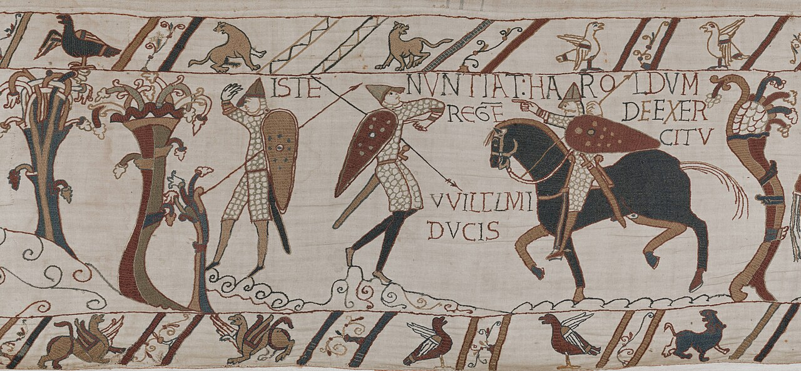
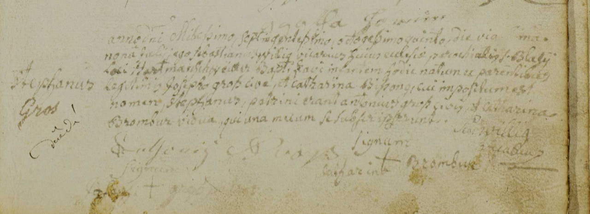
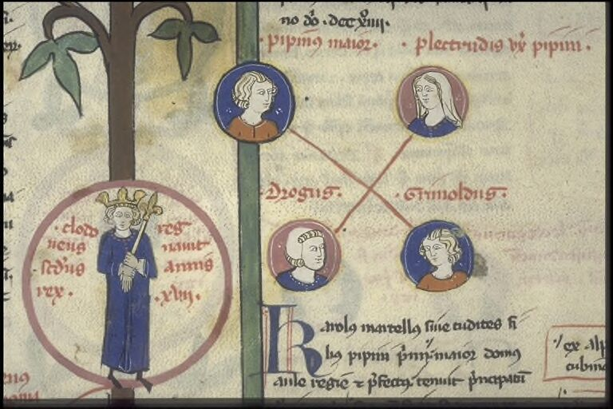

# Chronologia



> **🚧 Work in progress.** Le modèle (v0.13) est documenté et stable dans ses grandes lignes, le socle exécutable et l'import GeneWeb sont en construction. Rien n'est prêt pour un usage en production ; les interfaces, le schéma et les noms peuvent changer sans préavis.

Chronologia est un modèle de données historique **orienté événements et factoïdes**, à la croisée de la **prosopographie**, de la **généalogie** et de l'**analyse relationnelle**. Il est pensé pour exploiter des **documents d'archives** (actes, registres, chartes) avec une saisie assistée par modèles de langage, sous contrôle humain.

## L'idée en bref

| | |
|---|---|
|  | **Ce qui est écrit n'est pas ce que l'on en conclut.** Un acte de baptême est conservé tel quel (couche *Source*, insertion seule). Chaque information qu'il contient devient un **factoïde** : « ce document affirme que… ». |
|  | **Les conclusions sont révisables.** Les masques (« Pierre Martin » dans un acte) sont rattachés à des personnes, les factoïdes à des événements, les mentions de lieu à des lieux historiques, par *identification* avec un degré (certain / probable / possible) et un statut. Les désaccords entre sources restent visibles. |
|  | **Le tout forme un réseau.** Une fois les personnes, événements et lieux identifiés, on peut interroger les relations : parenté, parrainages, témoins, co-présences, trajectoires dans l'espace et dans le temps. |

### Quatre couches

- **Source** : ce qui est écrit, immuable (R10) ; aucune résolution à ce niveau (R13).
- **Interprétation** : ce que l'on conclut, révisable ; la machine propose, l'humain verse (R18).
- **Référentiels** : lieux, types, vocabulaires. Plus un schéma `saisie` pour les brouillons.
- **Travail** : ce que l'on cherche. Dépouillements et lacunes (ce qui a été lu, ce qui ne peut rien dire), notes de travail, questions et hypothèses, bac à sable, délégations à la machine.

Quatre agrégations symétriques, toutes par identification révisable : `PASSAGE → SOURCE`, `MASQUE → PERSONNE`, `FACTOIDE → EVENEMENT`, `MENTION_LIEU → LIEU_HISTORIQUE | SITE`. Les règles d'intégrité R1 à R34 sont décrites dans le document de référence.

### Le chercheur au centre

**La machine retire la copie, pas la lecture.** Le chercheur garde la main sur la connaissance produite :

- il délègue à la machine **en connaissance de cause** : taux d'erreur mesuré sur un jeu étalon, périmètre, seuil, suspension d'office en cas de dérive ; ce qui n'a pas été lu par un humain reste marqué et compté à part (R33) ;
- tout comptage montre ses hypothèses : identifications certaines, probables, possibles ; une absence n'est comptée que là où l'on a lu (R29) ;
- il peut revenir sur un document et le relire à l'aune de la première lecture et des pièces nouvelles, sans effacer la première (R34) ;
- tout participant peut formuler une question ou une hypothèse et la faire remonter ; le responsable scientifique l'arbitre, et aucune n'est enterrée (R32) ; une hypothèse se teste à part, dans un bac à sable (R31).

## Ce qui est en place, ce qui reste à faire

| État | Élément |
|---|---|
| ✅ | Document de référence du modèle (v0.13) et maquettes des cinq écrans |
| ✅ | Adaptateur d'import GeneWeb : mapping vers le modèle, clés déterministes, différentiel de deux lots d'import |
| ✅ | Stockage SQLite immuable : tables `source_*`, `interp_*`, `audit_*`, insertion seule par triggers (R10), rétractations tracées, vues des faits actifs |
| ✅ | Import de vraies bases GeneWeb (`.gw` exporté par `gwu`) : ~166 000 entités en ~8 s sur le plus gros fichier testé |
| ✅ | Service d'import : idempotence par empreinte SHA-256, réimport avec application du différentiel, tout-ou-rien |
| ✅ | Rapprochement d'homonymes entre bases par faisceau d'indices : propositions « possible » ou « probable », jamais « certain », à valider par l'humain (R26) |
| ✅ | Ligne de commande : `uv run python -m chronologia importer \| info-lot \| rechercher \| rapprocher` |
| ✅ | Outillage du jeu étalon (projet Hesdin-Lanchères) : inventaire des sources, tirage stratifié rejouable, mesures CER/WER et par champ, accord entre deux lectures ; commandes `etalon-inventaire \| etalon-tirer \| etalon-mesurer` |
| 🚧 | Projet Hesdin-Lanchères : inventaire des registres, conventions de transcription à valider, pilote puis transcription de l'étalon |
| 🚧 | Socle exécutable : schéma SQL complet, tests automatiques des règles, rejeu des scénarios du document |
| 🚧 | Validation des propositions d'identification et calibration du barème |
| ⏳ | Lieux : normalisation des mentions, articulation avec l'atelier de lieux de prosopo-gw |
| ⏳ | Saisie assistée par modèles de langage, évaluée sur ~50 actes annotés à la main |
| ⏳ | Écrans : validation et rattachements d'abord |
| ⏳ | Couche Travail : dépouillements, notes, questions du projet, délégation mesurée, relecture (décisions 39 à 56) |

## Terrain d'épreuve : le projet Hesdin-Lanchères 1872-1911

Plutôt que de valider le modèle sur des exemples choisis, on le confronte à une vraie étude d'histoire sociale, sur du volume. Le projet repose sur un **double comparatif** : dans le Pas-de-Calais, **Hesdin** (étude complète) face à **Saint-Omer** (témoin) ; dans la Somme, **Lanchères** (étude complète) face à **Saint-Valery-sur-Somme** (témoin). Deux questions : la démographie de ces communes et la reproduction sociale.

Le premier chantier pose la condition de toute délégation à la machine (R33) : un **jeu étalon** transcrit à la main, contre lequel on mesure la transcription automatique, Socface et une seconde lecture humaine.

- `etalon-inventaire` valide l'inventaire des registres d'une commune, avec ses lacunes motivées ;
- `etalon-tirer` tire l'échantillon (strates par type d'acte et par décennie, pilotes, pages de recensement, remontée avant 1872) ; les deux graines sont obligatoires et notées avant tout tirage ;
- `etalon-mesurer` produit les taux d'erreur par champ, par rôle et sur le texte (CER, WER), ou l'accord entre deux lectures.

Garde-fous : les données réelles restent **hors du dépôt** (toute commande refuse un chemin qui s'y trouve) ; les mesures ne contiennent que des comptes et des taux, jamais un nom ; une omission ne peut pas améliorer un score ; chaque taux rappelle qu'il porte sur l'échantillon tiré (R29). Détails : [note de conception](docs/superpowers/specs/2026-11-11-projet-hesdin-design.md), [mode opératoire](docs/projet-hesdin/mode-operatoire.md), [conventions de transcription](docs/projet-hesdin/conventions-transcription.md) (proposition à valider).

## Dépendance : le dépôt prosopo-gw

Le parseur GeneWeb n'est **pas** dans ce dépôt. Il vit dans [**prosopo-gw**](https://github.com/Relais4x100a2/prosopo-gw), qui en est la source unique. prosopo-gw est un monorepo `uv` à deux paquets : `core` (paquet Python `geneweb-py` : parseur, modèle objet, organisations, API) et `atelier` (`prosopo-gw-atelier`, atelier local de nettoyage des lieux, qui produit un export « pivot »). Chronologia ne dépend que de `core`. Chronologia le consomme comme dépendance locale éditable, déclarée dans `pyproject.toml` :

```toml
[tool.uv.sources]
geneweb-py = { path = "../prosopo-gw/core", editable = true }
```

Il faut donc cloner les deux dépôts côte à côte :

```text
TOLDOT/
├── chronologia/
└── prosopo-gw/
```

Toute adaptation du parsing requise par Chronologia se fait dans prosopo-gw, pas ici.

## Démarrage rapide

Prérequis : Python ≥ 3.12, [uv](https://docs.astral.sh/uv/), PostgreSQL + PostGIS (pour le socle SQL, en cours).

```bash
mkdir TOLDOT && cd TOLDOT
git clone git@github.com:Relais4x100a2/prosopo-gw.git
git clone git@github.com:Relais4x100a2/chronologia.git
cd chronologia
uv sync
uv run pytest
```

## Choix techniques

- PostgreSQL + PostGIS + `btree_gist` ; schémas `saisie`, `source`, `interp`, `ref`, `travail`.
- Coordonnées en WGS 84 (EPSG:4326), calculs métriques en Lambert‑93 (EPSG:2154).
- Backend Python (API FastAPI) ; interface React + TypeScript prévue.
- Connecteur GeneWeb : parseur Python `geneweb-py` (prosopo-gw) sur le `.gw` exporté par `gwu` ; la voie OCaml est abandonnée (décision 22).
- Modèles de langage derrière une passerelle (contrat JSON) ; déploiement hybride (serveur local, services en ligne, petits modèles locaux).

## Contenu du dépôt

| Chemin | Contenu |
|---|---|
| `docs/modele-evenement-masque-factoide.md` | Document de référence v0.13 : corpus, travail du chercheur, modèle Événement–Masque–Factoïde, lieux historiques et sites, import GeneWeb, interface, saisie assistée, implémentation. |
| `docs/etude-page-claude.html` | Version page du document, générée par `tools/build_page.py`. |
| `docs/etude-*.md` | Études d'autres logiciels (Heurist ; nodegoat, Arches, ResearchSpace ; cinq autres) et ce que le modèle leur emprunte. |
| `docs/relecture-oncle-neveu.md`, `docs/travail-du-chercheur.md` | Relecture critique du modèle et vision du travail du chercheur, d'où viennent les décisions 39 à 56. |
| `docs/geneweb/` | Références du format GeneWeb (`gwFormat.md`, `genewWikitext.md`). |
| `docs/projet-hesdin/` | Projet Hesdin-Lanchères : conventions de transcription (à valider) et mode opératoire du jeu étalon. |
| `docs/superpowers/` | Notes de conception (`specs/`) et plans d'implémentation (`plans/`). |
| `docs/img/` | Illustrations du README (voir crédits). |
| `chronologia/` | Code : modèle, adaptateur d'import GeneWeb, persistance, rapprochement d'homonymes, outillage du jeu étalon (`etalon/`), ligne de commande. |
| `maquettes/design/` | Les cinq écrans de la maquette (dépôt et lecture à voix haute, validation d'un acte, rattachements, conflit de date, conflit de lieu). |
| `tests/` | Tests automatiques. |
| `tools/` | Script de génération de la page. |
| `CLAUDE.md` | Contexte du projet pour Claude Code. |

Régénérer la page : `uv run --no-project --with markdown python tools/build_page.py`.

## Historique

Conçu de septembre à octobre 2026 dans une conversation Claude (Cowork). Versions successives du modèle : voir le journal des versions en tête du document de référence.

## Licence

[MIT](LICENSE). Les illustrations du README relèvent de leurs licences propres (voir ci-dessous).

## Crédits des illustrations

Images libres de droit, issues de Wikimedia Commons :

| Image | Source | Licence |
|---|---|---|
| Tapisserie de Bayeux, scène 50 | [Wikimedia Commons](https://commons.wikimedia.org/wiki/File:Bayeux_Tapestry_Scene_50_(cropped).jpg) | Domaine public |
| Registre paroissial, acte de Stephanus Gros (Archives d'Alsace) | [Wikimedia Commons](https://commons.wikimedia.org/wiki/File:Registre_paroissial_-_Stephanus_Gros.png) | Domaine public |
| Arbre généalogique des rois de France (Mérovingiens), BnF / Gallica | [Wikimedia Commons](https://commons.wikimedia.org/wiki/File:Arbre_g%C3%A9n%C3%A9alogique_des_rois_de_France._M%C3%A9rovingiens._(Dagobert_et_ses_fils)._Maires_du_palais_d%27Austrasie_(anc%C3%AAtres_des_Carolingiens)_-_btv1b10575624t_(3_of_5).jpg) | Domaine public |
| Réseau social (geralt) | [Wikimedia Commons](https://commons.wikimedia.org/wiki/File:Red_social.jpg) | CC0 |
