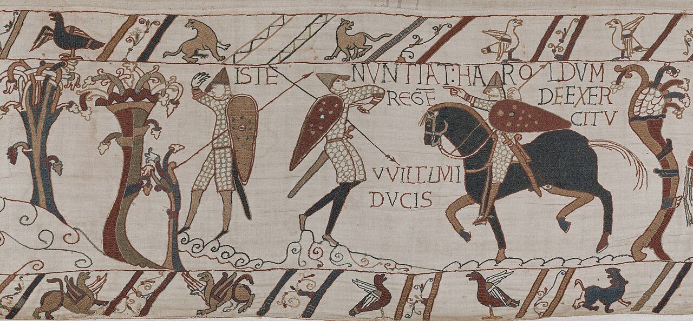
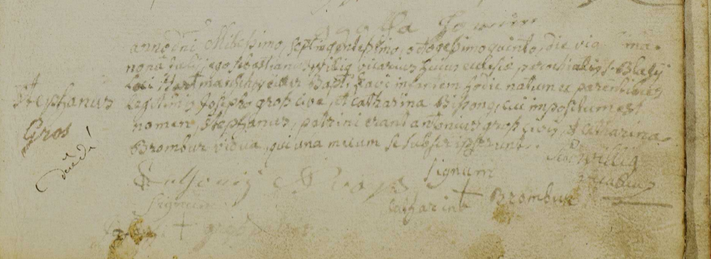
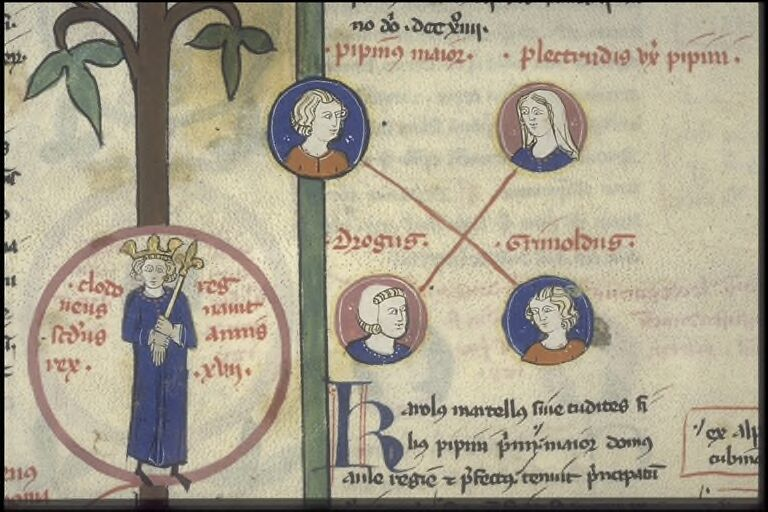

# Chronologia



> **🚧 Work in progress.** Le modèle (v0.8) est documenté et stable dans ses grandes lignes, le socle exécutable et l'import GeneWeb sont en construction. Rien n'est prêt pour un usage en production ; les interfaces, le schéma et les noms peuvent changer sans préavis.

Chronologia est un modèle de données historique **orienté événements et factoïdes**, à la croisée de la **prosopographie**, de la **généalogie** et de l'**analyse relationnelle**. Il est pensé pour exploiter des **documents d'archives** (actes, registres, chartes) avec une saisie assistée par modèles de langage, sous contrôle humain.

## L'idée en bref

| | |
|---|---|
|  | **Ce qui est écrit n'est pas ce que l'on en conclut.** Un acte de baptême est conservé tel quel (couche *Source*, insertion seule). Chaque information qu'il contient devient un **factoïde** : « ce document affirme que… ». |
|  | **Les conclusions sont révisables.** Les masques (« Pierre Martin » dans un acte) sont rattachés à des personnes, les factoïdes à des événements, les mentions de lieu à des lieux historiques, par *identification* avec un degré (certain / probable / possible) et un statut. Les désaccords entre sources restent visibles. |
|  | **Le tout forme un réseau.** Une fois les personnes, événements et lieux identifiés, on peut interroger les relations : parenté, parrainages, témoins, co-présences, trajectoires dans l'espace et dans le temps. |

### Trois couches

- **Source** : ce qui est écrit, immuable (R10) ; aucune résolution à ce niveau (R13).
- **Interprétation** : ce que l'on conclut, révisable ; la machine propose, l'humain verse (R18).
- **Référentiels** : lieux, types, vocabulaires. Plus un schéma `saisie` pour les brouillons.

Quatre agrégations symétriques, toutes par identification révisable : `PASSAGE → SOURCE`, `MASQUE → PERSONNE`, `FACTOIDE → EVENEMENT`, `MENTION_LIEU → LIEU_HISTORIQUE | SITE`. Les règles d'intégrité R1 à R25 sont décrites dans le document de référence.

## Ce qui est en place, ce qui reste à faire

| État | Élément |
|---|---|
| ✅ | Document de référence du modèle (v0.8) et maquettes des cinq écrans |
| ✅ | Adaptateur d'import GeneWeb : mapping vers le modèle, clés déterministes, différentiel de deux lots d'import |
| ✅ | Stockage SQLite immuable : tables `source_*`, `interp_*`, `audit_*`, insertion seule par triggers (R10), rétractations tracées, vues des faits actifs |
| ✅ | Service d'import : idempotence par empreinte SHA-256, réimport avec application du différentiel, tout-ou-rien |
| ✅ | Ligne de commande : `uv run python -m chronologia importer \| info-lot \| rechercher` |
| 🚧 | Socle exécutable : schéma SQL complet, tests automatiques des règles, rejeu des scénarios du document |
| 🚧 | Import d'une vraie base GeneWeb (export `gwu`) |
| ⏳ | Saisie assistée par modèles de langage, évaluée sur ~50 actes annotés à la main |
| ⏳ | Écrans : validation et rattachements d'abord |

## Dépendance : le dépôt toldot

Le parseur GeneWeb n'est **pas** dans ce dépôt. Il vit dans [**toldot**](https://github.com/Relais4x100a2/toldot) (package Python `geneweb-py`), qui en est la source unique. Chronologia le consomme comme dépendance locale éditable, déclarée dans `pyproject.toml` :

```toml
[tool.uv.sources]
geneweb-py = { path = "../toldot/core", editable = true }
```

Il faut donc cloner les deux dépôts côte à côte :

```text
TOLDOT/
├── chronologia/
└── toldot/
```

Toute adaptation du parsing requise par Chronologia se fait dans toldot, pas ici.

## Démarrage rapide

Prérequis : Python ≥ 3.12, [uv](https://docs.astral.sh/uv/), PostgreSQL + PostGIS (pour le socle SQL, en cours).

```bash
mkdir TOLDOT && cd TOLDOT
git clone git@github.com:Relais4x100a2/toldot.git
git clone git@github.com:Relais4x100a2/chronologia.git
cd chronologia
uv sync
uv run pytest
```

## Choix techniques

- PostgreSQL + PostGIS + `btree_gist` ; schémas `saisie`, `source`, `interp`, `ref`.
- Coordonnées en WGS 84 (EPSG:4326), calculs métriques en Lambert‑93 (EPSG:2154).
- Backend Python ; connecteur GeneWeb via l'export `gwu` (une voie OCaml reste envisagée).
- Modèles de langage derrière une passerelle (contrat JSON) ; déploiement hybride (serveur local, services en ligne, petits modèles locaux).

## Contenu du dépôt

| Chemin | Contenu |
|---|---|
| `docs/modele-evenement-masque-factoide.md` | Document de référence v0.8 : corpus, modèle Événement–Masque–Factoïde, lieux historiques et sites, import GeneWeb, interface, saisie assistée, implémentation. |
| `docs/etude-page-claude.html` | Version page du document, générée par `tools/build_page.py`. |
| `docs/geneweb/` | Références du format GeneWeb (`gwFormat.md`, `genewWikitext.md`). |
| `docs/img/` | Illustrations du README (voir crédits). |
| `chronologia/adapters/geneweb/` | Adaptateur d'import GeneWeb. |
| `maquettes/design/` | Les cinq écrans de la maquette (dépôt et lecture à voix haute, validation d'un acte, rattachements, conflit de date, conflit de lieu). |
| `tests/` | Tests automatiques. |
| `tools/` | Script de génération de la page. |
| `CLAUDE.md` | Contexte du projet pour Claude Code. |

Régénérer la page : `pip install markdown && python3 tools/build_page.py`.

## Historique

Conçu de septembre à octobre 2026 dans une conversation Claude (Cowork). Versions 0.1 à 0.8 du modèle : voir le journal des versions en tête du document de référence.

## Licence

[MIT](LICENSE). Les illustrations du README relèvent de leurs licences propres (voir ci-dessous).

## Crédits des illustrations

Images libres de droit, issues de Wikimedia Commons :

| Image | Source | Licence |
|---|---|---|
| Tapisserie de Bayeux, scène 50 | [Wikimedia Commons](https://commons.wikimedia.org/wiki/File:Bayeux_Tapestry_Scene_50_(cropped).jpg) | Domaine public |
| Registre paroissial, acte de Stephanus Gros (Archives d'Alsace) | [Wikimedia Commons](https://commons.wikimedia.org/wiki/File:Registre_paroissial_-_Stephanus_Gros.png) | Domaine public |
| Arbre généalogique des rois de France (Mérovingiens), BnF / Gallica | [Wikimedia Commons](https://commons.wikimedia.org/wiki/File:Arbre_g%C3%A9n%C3%A9alogique_des_rois_de_France._M%C3%A9rovingiens._(Dagobert_et_ses_fils)._Maires_du_palais_d%27Austrasie_(anc%C3%AAtres_des_Carolingiens)_-_btv1b10575624t_(3_of_5).jpg) | Domaine public |
| Réseau social (geralt) | [Wikimedia Commons](https://commons.wikimedia.org/wiki/File:Red_social.jpg) | CC0 |
