# Modèle Événement–Masque–Factoïde

**Étude documentaire, modèle conceptuel et stratégie d'import GeneWeb**
Version 0.13, 9 novembre 2026, préparée pour Guillaume Cayeux

> **Principe du modèle, depuis la v0.4 : quatre agrégations construites de la même façon**
> PASSAGE ⇢ SOURCE · MASQUE ⇢ PERSONNE · FACTOÏDE ⇢ ÉVÉNEMENT · MENTION DE LIEU ⇢ LIEU HISTORIQUE ou SITE
> À gauche, ce qui est écrit (couche Source, immuable). À droite, ce que l'on conclut (couche Interprétation, révisable). Chaque flèche est une identification révisable, qui porte un degré de confiance et une conclusion.

## Journal des versions

| Version | Changements |
|---|---|
| 0.1 | Modèle en trois couches (Source, Événement, Interprétation). Pivot sur l'événement. |
| 0.2 | Ajout de NOM, LOT_IMPORT et R9. Stratégie d'import GeneWeb. Analyse d'OCaml. |
| 0.3 | **Modèle symétrique.** L'événement passe dans la couche Interprétation ; le factoïde devient l'événement tel que la source le décrit, et porte les participations. Les chaînes de source brutes sont rattachées aux sources canoniques par le même mécanisme. Une structure d'identification commune sert aux trois agrégations. Ajouts : règles R10 à R12, choix d'implémentation (PostgreSQL, réification, projection en graphe), principes de l'interface de validation. |
| 0.4 | **Lieux en quatrième agrégation** : le lieu écrit (MENTION_LIEU) est rattaché au lieu du répertoire par une IDENT_LIEU ; la couche Source ne contient plus aucune résolution (R13). **Granularité tranchée** : un factoïde par acte, ou par épisode pour les sources narratives (R14). |
| 0.5 | **Lieu historique et site topographique distingués.** Le SITE (coordonnées physiques immuables) devient un référentiel ; le LIEU_HISTORIQUE (territoire ou institution datés) se décompose en noms, emprises, appartenances et localisations, chacun avec sa période de validité. Plusieurs hiérarchies territoriales coexistent. Règles R15 à R17. Section 4.8. |
| 0.5.1 | Ajustements PostGIS : site typé en point avec rayon d'incertitude, emprise approximative par point et rayon (zone tampon calculée à l'affichage), index spatiaux. Cas des paroisses partagées entre deux juridictions. |
| 0.6 | **Saisie assistée par modèles de langage** (section 7) : circuit dépôt, lecture à voix haute, extraction, validation ; modèles spécialisés derrière une passerelle ; déploiement hybride (serveur local, services en ligne, petits modèles en local). Ajouts au modèle : zone de brouillon, ancrage au mot, contributeur « agent », confiance d'extraction, indicateur lu ou déduit. Règles R18 à R21. |
| 0.7 | **Conclusions à effets multiples** (CONCLUSION_EFFET) et **contraintes temporelles** (CONTRAINTE_TEMPORELLE) : une même décision peut valider un lieu et resserrer la date d'un événement. État « incertitude assumée », distinct du conflit. Sources hors calcul : jamais effacées. Calculs métriques en Lambert‑93. Règles R22 à R24. Écrans de la maquette et règles d'interface consignés (6.1 à 6.6). |
| 0.7.1 | Consolidation du dossier. Question ouverte ajoutée en 9.2 (point 6) : faut-il une notion d'organisation ? Aucun changement de modèle ni de règle. |
| 0.7.2 | **Provenance de fichier sur le PASSAGE** : `fichier_source`, `ligne_debut`, `ligne_fin` (4.4, décision 7 en 9.1). Import GeneWeb : rôle `officier` pour les témoins `#offi` (décision 8) et date déclarée prise telle que normalisée par l'analyseur (décision 9). Aucune nouvelle règle d'intégrité. |
| 0.7.3 | **`date_brute` sur le FACTOÏDE** (4.4, décision 9 en 9.1) : la date telle qu'écrite dans la source est conservée à côté de la date normalisée et des bornes. Aucune nouvelle règle d'intégrité. |
| 0.7.4 | **Import GeneWeb de QUALITE et de MENTION_LIEU** : `categorie` et `rang` sur QUALITE (4.4, décision 10) ; désignation « moderne » des lieux importés et IDENT_LIEU différée jusqu'aux référentiels (décision 11). Aucune nouvelle règle d'intégrité. |
| 0.7.5 | **LOT_IMPORT, `cle_externe` et notes à l'import GeneWeb** : `nb_entites` sur LOT_IMPORT, `cle_externe` sur PASSAGE (4.4), formats de clés (5.3), réimport idempotent (5.8 étape 6) ; décisions 12 et 13. Aucune nouvelle règle d'intégrité. |
| 0.7.6 | **`cle_famille` sur le FACTOÏDE** (4.4, décision 14) : clé déterministe des familles GeneWeb pour le réimport. Aucune nouvelle règle d'intégrité. |
| 0.7.7 | **Événements déclarés sur la ligne de personne** (5.3, décision 15) : naissance, baptême, décès et inhumation écrits sur la ligne d'un enfant ou d'un conjoint donnent chacun un factoïde, sans nouvelle règle. |
| 0.7.8 | **Différentiel de lots** (5.8 étape 6, décision 16) : comparaison pure de deux LOT_IMPORT d'un même corpus (ajouts, invariants, modifications, rétractions). Aucune nouvelle règle d'intégrité. |
| 0.7.9 | **Différentiel des CONCLUSION** (décision 16 complétée) : les notes de personne sont comparées par cible. Aucune nouvelle règle d'intégrité. |
| 0.7.10 | **Note de témoin** : PARTICIPATION porte un champ optionnel `note` (le `wnote` GeneWeb, rattaché au témoin qui précède). Le texte nu des blocs `pevt`, `fam` et `fevt` est conservé (R13). Aucune nouvelle règle. |
| 0.7.11 | **Événements familiaux `fevt` exhaustifs** : chaque tag d'un bloc `fevt` donne un FACTOIDE typé (`mariage`, `divorce`, `separation`, `engagement`, `contrat_mariage`, `bans_mariage`, `licence_mariage`, `non_mariage`, `non_mention`, `annulation`, `pacs`, `residence`) ; un tag inconnu garde son écriture d'origine comme type libre. Une famille sans conjoint connu (`fam ? ? + ? ?`) est importée avec ses enfants et événements ; sa clé porte le premier enfant. Aucune règle nouvelle (R13 appliquée). |
| 0.7.12 | **Persistance SQLite** : décision 18. Socle de développement et de test en SQLite (`:memory:` ou fichier local), schémas PostgreSQL simulés par préfixe de table (`source_`, `interp_`, `audit_`). R10 appliquée par triggers `BEFORE UPDATE` et `BEFORE DELETE` ; rétractation par `audit_retractation`. Aucune règle nouvelle. |
| 0.7.13 | **Application du différentiel à la base** : décision 18 complétée. `appliquer_diff` retire de la vue active les occurrences du lot ancien que le lot nouveau remplace, par trois motifs d'audit : `retractation`, `modification`, `reconduction`. Vues actives `source_factoide_actif` et `interp_conclusion_actif`. Aucune règle nouvelle. |
| 0.8 | **Identification prosopographique MASQUE ⇢ PERSONNE** (4.4, décision 19). PERSONNE réduite à une coquille dont tout est calculé (R8), fusion par `same_as_id`. Le statut d'une identification devient un **journal** (IDENT_PERSONNE_STATUT) : chaque décision est une ligne nouvelle, le statut courant est la dernière (R10 tenue sans exception). **Faisceau d'indices** (INDICE) : chaque indice comparé est une ligne, calculée par une règle versionnée ou jugée par un humain. CONTRIBUTEUR typé (humain, agent, import). CONCLUSION sans cible obligatoire, ses conséquences passant par CONCLUSION_EFFET (R22). Règle R25. |
| 0.8.1 | **Identifications de l'import GeneWeb** (décision 19, 5.3, 5.8). Une personne par clé GeneWeb, portée en `ref` ; tous les masques de la clé lui sont rattachés. Au réimport, la personne est réutilisée et les identifications du lot ancien sortent de la vue active par `audit_retractation`, comme les factoïdes. Une décision humaine en désaccord avec l'import n'est jamais écrasée : la nouvelle identification reste « proposé » (R24). R18 précisée : un agent ne verse que des propositions, il ne rejette pas plus qu'il n'active. |
| 0.9 | **Rapprochement d'homonymes par faisceau d'indices** (décision 20). Un agent compare les personnes de bases différentes dont le nom normalisé concorde, masque par masque, selon trois familles de règles versionnées (onomastique, chronologie, parenté), et propose une identification « possible » ou « probable » quand le barème le justifie. Logique de calcul pure, séparée de la persistance. Règle R26 : encadrement des rapprochements calculés. |
| 0.9.1 | Questions ouvertes ajoutées en 9.2 : supports imprimés, audio et vidéo (point 7) ; outils d'annotation externes et données d'entraînement (point 8). Renvoi depuis la section 7.1. Aucun changement de modèle ni de règle. |
| 0.9.2 | **Alignement sur prosopo-gw** (ex-toldot, renommé) et sur ses corrections de l'analyseur (décision 21). Aucune nouvelle règle d'intégrité. |
| 0.9.3 | **Connecteur GeneWeb en Python** (décision 22) : le parseur `geneweb-py` du monorepo prosopo-gw lit le `.gw` ; la voie OCaml (8.3) est abandonnée et la section 8 devient « PostgreSQL et Python ». Nouveaux éléments de prosopo-gw versés aux questions ouvertes : organisations déduites (9.2-6) et atelier de nettoyage des lieux (9.2-9). Aucun changement de modèle ni de règle. |
| 0.9.4 | **Mode de détermination et calendrier de la date** (4.4, 5.6, décision 23), repris de l'étude de Heurist (`docs/etude-heurist.md`) : le FACTOIDE porte `determination_date` (attestée, déduite, estimée, inconnue) ; `calendrier` prend une liste fermée qui inclut le républicain. **Connecteurs Heurist** inscrits à la feuille de route, après le socle PostgreSQL (décision 24). **R27** (décision 25) : la non‑reproposition d'une identification déjà décidée, posée par R26 pour les personnes, s'étend aux quatre agrégations. |
| 0.10 | **Reprises de nodegoat, Arches et ResearchSpace** (`docs/etude-nodegoat-arches-researchspace.md`, décisions 26 à 32) : CONTRAINTE_TEMPORELLE porte une direction et un écart (4.4) ; CONCLUSION porte un `mode` (observation, adoption, inférence) et peut reposer sur d'autres conclusions (nouvelle entité CONCLUSION_PREMISSE, 4.4, 4.7) ; ANOMALIE_IMPORT garde les anomalies de chaque lot (4.4, 5.8) ; FORME_LIEU retient les résolutions des formes écrites de lieux (4.4, 4.8) ; EDTF comme syntaxe de saisie et d'export (5.6) ; cycle de publication à préciser avec les connecteurs (décision 32). **R28** : pas de raisonnement circulaire, pas de retrait en cascade silencieux. |
| 0.10.1 | **Reprises de Gramps, World Historical Gazetteer, Recogito et FactGrid** (`docs/etude-cinq-logiciels.md`, décisions 33 à 38) : contrôles de vraisemblance des personnes reconstruites (6.7) ; calcul « possiblement vivant » qui alimente `acces` et R21 (4.4, 7.3) ; Linked Places Format et candidats de lieux venus de référentiels externes (4.8) ; statut « reporté » dans la file de décisions (6.8) ; ancrage au format W3C Web Annotation (4.4, 7.6) ; connecteur Wikibase / FactGrid à la feuille de route. Questions ouvertes : 9.2‑6 enrichie (groupes dans APIS), nouvelle 9.2‑10 (valeur inconnue ou absence attestée). Aucune nouvelle règle d'intégrité. |
| 0.11 | **Le travail du chercheur** (`docs/relecture-oncle-neveu.md`, décisions 39 à 43) : nouvelle couche **Travail** (4.2, 4.4, schéma `travail` en 8.1) avec DEPOUILLEMENT et LACUNE (ce qui a été lu, ce qui ne peut rien dire) et NOTE de travail ; table de tri des homonymes (6.9) ; comptages à trois étages (6.10) ; carnet de notes (6.11) ; saisie en sténo (7.8). Nouvelles règles : R29 (un comptage montre ses hypothèses) et R30 (pas de texte libre sans statut). 9.2‑10 éclairée par la décision 39. |
| 0.12 | **Le chercheur et le responsable scientifique** (`docs/travail-du-chercheur.md`, décisions 44 à 54) : doctrine « la machine retire la copie, pas la lecture », cinq gestes, rôles et parcours du chercheur (1.1) ; trois modes de dépouillement et part minimale de lecture humaine (7.9) ; travail hors ligne et reprise (7.10) ; tableau des curiosités (6.12) ; hypothèses testables, bac à sable « et si », résultats négatifs conservés (6.13) ; questions et hypothèses remontées par tout participant, arbitrées par le responsable scientifique (6.14). Nouvelles entités ARBITRAGE et SCENARIO ; rôle du CONTRIBUTEUR. Nouvelles règles : R31 (une hypothèse se teste à part) et R32 (une question remontée n'est jamais enterrée). |
| 0.13 | **Dominer la machine, revenir sur ses pas** (décisions 55 et 56, à la demande du porteur du projet) : délégation mesurée à la machine, sur un jeu étalon, avec un taux d'erreur connu, un périmètre, un seuil et une suspension automatique (7.11, R33, R18 précisée) ; relecture d'un document à l'aune de la première lecture et des pièces nouvelles (7.12, R34). Nouvelle entité DELEGATION ; attributs `validation` du passage et `relit_id` du dépouillement. Doctrine du 1.1 précisée. |

## Sommaire

1. [Objectif et contexte](#1-objectif-et-contexte)
2. [Corpus de référence](#2-corpus-de-référence)
3. [Synthèse des concepts clés](#3-synthèse-des-concepts-clés)
4. [Modèle conceptuel v0.4](#4-modèle-conceptuel-v04)
5. [Import depuis GeneWeb](#5-import-depuis-geneweb)
6. [Interface de validation](#6-interface-de-validation)
7. [Saisie assistée par modèles de langage](#7-saisie-assistée-par-modèles-de-langage)
8. [Implémentation : PostgreSQL et Python](#8-implémentation--postgresql-et-python)
9. [Décisions et questions ouvertes](#9-décisions-et-questions-ouvertes)
10. [Sources](#10-sources)

---

## 1. Objectif et contexte

Le but est de concevoir un modèle de données historique **orienté événements**, à la croisée de la généalogie, de la prosopographie et de l'analyse relationnelle.

- **Entité pivot :** l'événement, ancré dans le temps et dans l'espace. Depuis la v0.3, on distingue l'événement *tel qu'une source le décrit* (le factoïde) de l'événement *tel que le chercheur le reconstitue*.
- **Entités rattachées :** personnes, masques et rôles (une personne agit sous un rôle précis dans un événement donné), lieux, témoins, sources et preuves, types d'événements.
- **Principe :** modèle orienté **factoïde**. L'information tirée des sources est normalisée, l'incertitude et les points de vue divergents sont conservés.
- **Contrainte d'import :** une partie des données viendra de bases **GeneWeb**.

Précision de vocabulaire : IBM écrit **ELP** (Entity, Link, Property), et non EPL. Dans Analyst's Notebook, un *item type* désigne un type d'entité ou un type de lien. Les attributs forment une notion à part (*attribute classes*), et un événement n'y est pas une classe distincte : c'est un type d'entité affiché en *event frame* sur la vue chronologique.

### 1.1 Le travail du chercheur (v0.12)

Le modèle garantit la preuve ; il doit aussi servir le travail qui la produit (`docs/travail-du-chercheur.md`, décisions 44 à 54).

**Doctrine (décision 44) : la machine retire la copie, pas la lecture.** Le chercheur n'est ni écarté du dépouillement ni dispensé de le faire : la découverte naît de la lecture, on ne juge bien que ce qu'on sait faire, et la machine ne se mesure que contre une lecture humaine. Rien n'interdit à un humain une tâche « de petite main ».

**Dominer la machine (décision 55).** On ne pourra pas tout relire : on délègue donc à la machine, mais **en connaissance de cause**. Une délégation se mesure d'abord sur un jeu étalon lu par des humains ; elle a un périmètre, un taux d'erreur connu et un seuil ; elle est signée par le responsable scientifique, contrôlée en continu, et suspendue d'office si la machine dérive (7.11, R33). Ce qui a été versé sans lecture humaine reste marqué comme tel, se compte à part et peut toujours être relu. Le chercheur connaît ainsi ses propres limites (le même étalon mesure les lecteurs humains) et impose les siennes à l'outil : hors délégation, la machine ne fait que proposer, et le jugement ne se délègue jamais (R18). Valider sans avoir lu n'est permis que sous une délégation en cours.

**Revenir sur ses pas (décision 56).** On découvre souvent en relisant. L'outil permet de rouvrir un document déjà dépouillé pour une nouvelle lecture, à l'aune de la première et des pièces trouvées depuis ; la première lecture n'est jamais effacée (7.12, R34).

| Geste | Ce qu'il produit | Couche | Rôle de la machine |
|---|---|---|---|
| **Lire** : déchiffrer, relever, transcrire | Ce que dit la source | Source | Elle prépare, ou relit en second (7, 7.8, 7.9). |
| **Relier** : rapprocher masques, actes, lieux | Des identifications | Interprétation | Elle propose des candidats et des piles (R18, R26, 6.9). |
| **Juger** : trancher, argumenter, assumer une incertitude | Des conclusions | Interprétation | Aucun : elle signale, elle ne décide jamais (R18, R25). |
| **Chercher** : remarquer, supposer, vérifier | Des notes, des hypothèses, des questions | Travail | Elle montre ce qui détonne et calcule les conséquences (6.12, 6.13). |
| **Écrire** : notices, tableaux, publication | Des vues et des instantanés | Vues | Elle met en forme et produit l'apparat de notes. |

**Rôles (décision 52).** Le rôle d'un contributeur est déclaré pour le projet (CONTRIBUTEUR, 4.4).

| Rôle | Ce qu'il fait | Ce qui lui revient en propre |
|---|---|---|
| **Responsable scientifique** | Définit les questions et le périmètre du corpus ; fixe la méthode de dépouillement, les abréviations et les seuils (barème, vraisemblance, « possiblement vivant ») ; choisit le mode de chaque dépouillement (7.9) ; suit la qualité (taux de correction, accord entre lecteurs, couverture) ; forme. | Désigner la vue de référence quand des chercheurs divergent (R11, l'avis écarté restant conservé) ; arbitrer les questions et hypothèses remontées (6.14, R32) ; signer les instantanés publiés ; décider de ce que la machine fait en premier. |
| **Chercheur** | Dépouille, trie (6.9), note, formule et teste des hypothèses (6.13), argumente, rédige. | Ses conclusions, signées ; le droit de faire à la main ce que la machine sait faire ; le droit de garder son désaccord. |
| **Contributeur en formation** | Dépouille, d'abord sur des actes déjà validés, puis sur des sources réelles. | Ses saisies, relues avant validation (`relecteur_id` du dépouillement). |
| **Agent** | Lit en premier ou en second, propose, calcule contrôles, comptages et curiosités. | Rien : il ne décide, ne rejette ni n'écrit de note (R18, R25, R30). |

Tout participant, quel que soit son rôle, peut formuler une question ou une hypothèse et la faire remonter au projet (décision 54, 6.14).

**Parcours d'une journée (décision 53).** 1. Le carnet : notes ouvertes, hypothèses réveillées, questions arbitrées (6.11, 6.14). 2. La couverture : ce qui reste à lire, les lacunes (6.10). 3. Le dépouillement : en sténo, depuis l'image, ou hors ligne (7.8 à 7.10). 4. Le tri : les homonymes en piles (6.9) et la file de décisions, par séances. 5. La recherche : curiosités, hypothèses, bac à sable (6.12, 6.13). 6. L'écriture : notices et comptages à trois étages (6.10).

---

## 2. Corpus de référence

Treize références en quatre familles.

### 2.1 Prosopographie et factoïdes

#### 01. Bradley & Short (2005)

- **Référence :** Bradley, J. & Short, H. (2005). « Texts into databases: the evolving field of new-style prosopography ». *Literary and Linguistic Computing*, 20 (suppl.), p. 3‑24.
- **Nature :** papier académique, le texte fondateur.
- **Modèle :** un factoïde est une affirmation tirée d'un passage de source. Elle relie une ou plusieurs personnes, un lieu et une date. La base ne dit pas qui était X : elle enregistre ce que la source S dit de X, et l'identité de la personne est reconstruite à partir de ces affirmations.
- **À retenir :** le factoïde sert de pivot entre la source et la personne. La référence précise dans la source est obligatoire, et plusieurs affirmations contradictoires peuvent coexister sans être fusionnées.

#### 02. Pasin & Bradley (2015)

- **Référence :** Pasin, M. & Bradley, J. (2015). « Factoid-based prosopography and computer ontologies: towards an integrated approach ». *Digital Scholarship in the Humanities*, 30(1), p. 86‑97.
- **Nature :** papier académique, avec une ontologie OWL (la Factoid Prosopography Ontology, FPO).
- **Modèle :** le modèle factoïde est formalisé en ontologie et aligné sur CIDOC‑CRM. Chaque personne est citée à travers une *person reference* propre à la source, qu'on rattache ensuite à la personne consolidée.
- **À retenir :** c'est la base de la séparation entre personne et masque. Le lien d'identification entre les deux est lui-même une assertion qu'on peut remettre en cause.

#### 03. SNAP:DRGN (2016)

- **Référence :** Bodard, G., Cayless, H., Depauw, M., Isaksen, L., Lawrence, K. F., Rahtz, S. (2016). « Standards for Networking Ancient Prosopographies ». In G. Bodard & M. Romanello (dir.), *Digital Classics Outside the Echo‑Chamber*, Ubiquity Press, p. 29‑44.
- **Nature :** papier académique et spécification RDF.
- **Modèle :** SNAP relie des bases prosopographiques sans les fusionner. Chaque base garde ses propres URI de personnes. Des liens de co-référence (*same as*, *may be the same as*) et des relations typées (parenté, relations sociales) sont publiés en Linked Data.
- **À retenir :** l'identification se fait par des liens explicites, jamais par écrasement. Le vocabulaire de relations sociales et de parenté est réutilisable.

#### 04. IPIF (2019)

- **Référence :** Vogeler, G., Vasold, G., Schlögl, M. (2019). « Data exchange in practice: Towards a prosopographical API ». *Biographical Data in a Digital World 2019*, CEUR‑WS vol. 3152. Spécification associée : IPIF (International Prosopography Interchange Framework).
- **Nature :** papier académique et spécification d'API (OpenAPI).
- **Modèle :** l'API expose quatre ressources : Factoid, Person, Source et Statement. Un factoïde relie une personne et une source à un ou plusieurs *statements* typés (rôle, date, lieu, personnes liées).
- **À retenir :** un gabarit prêt à l'emploi pour le triangle source → factoïde → personne, avec l'auteur et la date de saisie.

### 2.2 Standards et ontologies

#### 05. CIDOC‑CRM

- **Référence :** CIDOC‑CRM, version 7.1.x. CIDOC CRM SIG / ICOM ; norme ISO 21127:2023.
- **Nature :** standard (ontologie formelle).
- **Modèle :** **E5 Event** se spécialise en E7 Activity, E63/E64 (début et fin d'existence), E67 Birth, E69 Death, E85 Joining, E86 Leaving, etc. Un événement est ancré par P4 *has time‑span* (qui porte des bornes floues, P82a/P82b) et par P7 *took place at*. Les participants sont reliés par P11 *had participant* ou P14 *carried out by*. Le rôle est porté par une propriété de propriété, **P14.1 in the role of**, réifiée dans la version 7 sous la forme PC14.
- **À retenir :** l'événement est un pivot légitime. Le rôle est porté par le lien entre la personne et l'événement, pas par la personne. Les intervalles flous sont gérés.

#### 06. CRMinf

- **Référence :** CRMinf, Argumentation Model. Stead, Doerr et al., CIDOC CRM SIG.
- **Nature :** extension du CIDOC‑CRM.
- **Modèle :** I2 *Belief* porte une valeur de vérité (I6) sur un ensemble de propositions (I4 *Proposition Set*). Les croyances sont produites par une inférence (I5) ou par l'adoption de l'avis d'une autorité ou d'une source (I7 *Belief Adoption*).
- **À retenir :** l'outil formel pour les points de vue et l'incertitude : qui affirme quoi, avec quel degré de confiance, sur quelle base.

#### 07. GEDCOM X

- **Référence :** GEDCOM X Conceptual Model. FamilySearch, spécification 1.0, gedcomx.org.
- **Nature :** spécification technique.
- **Modèle :** le modèle sépare les *records* (personas extraits d'une source) des *conclusions* (personnes reconstruites), liés par un *EvidenceReference*. Un Event porte date et lieu ; ses participants sont des **EventRole** typés : *Principal*, *Participant*, *Official*, *Witness*. Chaque élément porte une **Attribution** et une **confidence**, et renvoie aux *SourceDescription*.
- **À retenir :** la correspondance la plus directe avec notre architecture. Persona = masque, EventRole = rôle, le témoin est un rôle natif, et la preuve est chaînée jusqu'à la source.

#### 08. GENTECH

- **Référence :** GENTECH Genealogical Data Model. Lexicon Working Group, National Genealogical Society, 1998 ; révision 2000.
- **Nature :** spécification (modèle logique).
- **Modèle :** chaque **Assertion** relie un sujet (Persona, Event, Characteristic ou Group) à une valeur, en citant une source. Les personas sont regroupés en personnes par des assertions d'identité, et une assertion peut être tirée d'autres assertions.
- **À retenir :** l'ancêtre de GEDCOM X et le modèle le plus proche du factoïde en généalogie. Les **groupes** (familles, confréries, foyers) y sont des sujets à part entière.

#### 09. FHISO

- **Référence :** FHISO. Extended Legacy Format (ELF) : Data Model et Serialisation ; vocabulaire *Citation Elements* (fhiso.org/TR).
- **Nature :** standards techniques.
- **Modèle :** ELF formalise un modèle compatible GEDCOM 5.5.1, avec des extensions déclarées. *Citation Elements* décompose une citation en éléments typés (auteur, titre, dépôt, localisation…). FHISO a aussi produit un standard de dates.
- **À retenir :** l'interopérabilité avec GEDCOM, la normalisation des sources, et un traitement des dates approximatives et des calendriers anciens.

#### 10. Bio CRM (2018)

- **Référence :** Tuominen, J., Hyvönen, E., Leskinen, P. (2018). « Bio CRM: A Data Model for Representing Biographical Data for Prosopographical Research ». *BD2017*, CEUR‑WS vol. 2119, p. 59‑66.
- **Nature :** papier académique et ontologie.
- **Modèle :** Bio CRM étend CIDOC‑CRM avec trois catégories de rôles : **rôles unaires durables** (profession, titre), **rôles binaires durables** (relations entre personnes) et **rôles de participation à un événement** (témoin, parrain, officiant).
- **À retenir :** la grille pour typer les masques et les rôles, sans confondre rôle ponctuel, statut durable et relation.

### 2.3 Modèles d'investigation (IBM i2)

#### 11. IBM i2 Analyst's Notebook

- **Référence :** IBM i2 Analyst's Notebook : Entity Link Properties (ELP) et Chart Reference. IBM, puis i2 Group.
- **Nature :** documentation technique.
- **Modèle :** un graphe d'entités typées et de liens typés, qui peuvent être orientés, multiples ou fusionnés. Les *attribute classes* portent les valeurs et les *cards* les éléments de preuve (source, date, notation). La vue chronologique place les événements en *event frames* sur des *theme lines*, une ligne par personne.
- **À retenir :** un événement peut être un lien daté entre deux personnes, ou une entité reliée à ses participants ; pour notre modèle, c'est la seconde forme qu'il faut retenir. Les cards donnent une traçabilité élément par élément, et la notation des sources (grille de type Amirauté, fiabilité × crédibilité) s'applique aux témoignages.

#### 12. IBM i2 Enterprise Insight Analysis

- **Référence :** IBM i2 Enterprise Insight Analysis Data Model White Paper (v4.1, v4.3) ; documentation « The i2 Analyze data model » (docs.i2group.com).
- **Nature :** livre blanc et spécification technique.
- **Modèle :** le schéma i2 Analyze définit des types d'entités, de liens et de propriétés, ainsi que les couples source/cible autorisés pour chaque type de lien. Chaque *item* est construit à partir de *records* qui portent chacun leur provenance et leur notation.
- **À retenir :** la séparation entre item et records correspond au couple personne / factoïde. Le schéma contraint les types de liens, et la provenance par record permet de fusionner ou dissocier des entités sans perte.

### 2.4 Format d'import

#### 13. GeneWeb

- **Référence :** GeneWeb. Daniel de Rauglaudre (INRIA, 1997‑), aujourd'hui maintenu par la communauté et Geneanet ; licence GPL. Version 7.1.0‑beta2 (décembre 2024). Documentation du format `.gw` (geneweb.tuxfamily.org) et types OCaml du module `Def` (github.com/geneweb/geneweb).
- **Nature :** logiciel libre, format de fichier et types OCaml.
- **Modèle :** modèle centré sur la personne et la famille, au niveau des conclusions. Une personne est identifiée par son nom, son prénom et un numéro d'occurrence. Depuis la version 7, des événements personnels (`pevt`) et familiaux (`fevt`) portent date, lieu, source, note et témoins. La 7.1 type les témoins : parrain, officier civil, officier religieux, informateur, présent, mentionné.
- **À retenir :** c'est la source d'import prioritaire. Ses témoins typés et ses dates à précision se transposent bien. En revanche, il n'a ni masque, ni entité source, ni lieu structuré : il faut les reconstruire à l'import (section 5).

---

## 3. Synthèse des concepts clés

| Concept | Définition pour notre modèle | Références |
|---|---|---|
| Événement pivot | Distingué en deux : le factoïde (événement tel que raconté) et l'événement reconstitué qui regroupe les factoïdes. | 05, 07, 11, 13 |
| Masque | Mention d'une personne telle que la source la présente. Distinct de la personne consolidée. | 01, 02, 07, 08 |
| Identification | Lien révisable d'un élément écrit vers une entité conclue : passage → source, masque → personne, factoïde → événement. | 03, 07, 12 |
| Rôle de participation | Porté par le lien masque ↔ événement, pas par la personne. | 05, 07, 10, 13 |
| Rôles durables | Statut unaire (profession) et relation binaire (parenté), séparés des rôles ponctuels. | 03, 10 |
| Factoïde | Unité atomique : source + localisation + énoncé + auteur de saisie. | 01, 04, 08 |
| Point de vue et confiance | Qui affirme, sur quelle base, avec quel degré de confiance. | 06, 07 |
| Notation de la preuve | Fiabilité de la source × crédibilité de l'information. | 11 |
| Témoin | Rôle dans l'événement et, le cas échéant, déclarant d'une affirmation. | 06, 07, 13 |
| Typage contraint des liens | Chaque type de lien déclare les types d'entités qu'il peut relier. | 02, 12 |
| Provenance d'import | Chaque donnée garde le lot, le fichier et la clé d'origine. | 12, 13 |

---

## 4. Modèle conceptuel v0.4

### 4.1 Principe : quatre agrégations symétriques

Rattacher deux passages d'archives au même événement, c'est déjà interpréter. La v0.3 en a tiré la conséquence, et la v0.4 l'étend aux lieux : **tout ce qui regroupe des éléments écrits relève de l'Interprétation**, et ce regroupement se fait toujours de la même façon.

| Ce qui est écrit (Source) | Ce qui est conclu (Interprétation) | Identification | Question tranchée par le chercheur |
|---|---|---|---|
| PASSAGE (citation brute et localisation) | SOURCE (document canonique) | IDENT_SOURCE | Ces citations renvoient-elles au même document ? |
| MASQUE (personne telle que nommée) | PERSONNE (individu reconstruit) | IDENT_PERSONNE | Ces mentions désignent-elles le même individu ? |
| FACTOIDE (événement tel que raconté) | EVENEMENT (événement reconstitué) | IDENT_EVENEMENT | Ces récits décrivent-ils le même événement ? |
| MENTION_LIEU (lieu tel qu'écrit) | LIEU_HISTORIQUE (territoire daté) ou SITE (emplacement physique), voir 4.8 | IDENT_LIEU | Ce « Saint‑Aubin » est-il Saint‑Aubin‑sur‑Scie, Saint‑Aubin‑des‑Bois, ou une paroisse disparue ? |

Les quatre identifications ont **la même structure** : un élément de départ, une cible, un degré (certain, probable, possible), un statut (proposé, actif, rejeté) et une conclusion qui l'argumente. Une seule logique à coder, à tester et à présenter dans l'interface.

La résolution d'un lieu historique est souvent une interprétation à part entière. En v0.3, `FACTOIDE.lieu_id` la plaçait dans la couche Source : le jour où un chercheur prouve que ce n'était pas le bon Saint‑Aubin, il aurait fallu modifier un factoïde, contre R10. La v0.4 corrige ce point.

### 4.2 Les couches

| Couche | Entités | Propriétés |
|---|---|---|
| **Source** (ce qui est écrit) | PASSAGE, FACTOIDE, MASQUE, PARTICIPATION, QUALITE, RELATION, NOM, MENTION_LIEU | **Immuable**, en insertion seule. Le factoïde est le seul point d'ancrage : il porte la date déclarée, le type d'événement décrit, ses mentions de lieu, et c'est à lui que se rattachent les participations. |
| **Interprétation** (ce que l'on conclut) | SOURCE, PERSONNE, EVENEMENT, LIEU_HISTORIQUE (+ NOM_LIEU, EMPRISE, APPARTENANCE, LOCALISATION), IDENT_SOURCE, IDENT_PERSONNE, IDENT_EVENEMENT, IDENT_LIEU, CONCLUSION | Révisable. Chaque regroupement porte un auteur, un degré et des arguments. Plusieurs points de vue coexistent ; un seul est « actif » à un instant donné. |
| **Référentiels** | TYPE_EVENEMENT, ROLE, CONTRIBUTEUR, LOT_IMPORT, SITE | Vocabulaires contrôlés (alignés sur CIDOC‑CRM et Bio CRM), provenance des imports et sites topographiques (coordonnées immuables). |
| **Travail** (ce que l'on cherche, v0.11) | DEPOUILLEMENT, LACUNE, NOTE, ARBITRAGE, SCENARIO, DELEGATION | Révisable et journalisé. Décrit le travail de l'équipe, pas le passé : ce qui a été lu, ce qui ne peut rien dire, les pistes en cours. N'entre dans aucune vue de l'interprétation, à une exception près : la couverture des dépouillements donne leur sens aux absences (R29). |
| **Vues dérivées** | Participants d'un événement, intervalle d'un événement, fiche consolidée d'une personne, réseau | Calculées à partir des identifications actives, jamais saisies à la main. |

Ce qui a changé en v0.3 par rapport à la v0.2 :

- EVENEMENT quitte la couche Source et devient un regroupement de factoïdes.
- PARTICIPATION se rattache au factoïde, et non plus à l'événement. Les participants d'un événement sont une vue.
- SOURCE devient le document canonique ; la chaîne telle qu'écrite ou importée reste dans PASSAGE.
- LIEU passe dans les référentiels (v0.3), puis dans la couche Interprétation (v0.4).

Ce qui change en v0.4 :

- Le lieu tel qu'écrit devient une MENTION_LIEU, rattachée au factoïde. Elle précise sa fonction : lieu de l'événement, domicile d'un masque (« demeurant à »), lieu d'origine, lieu attaché à un titre.
- LIEU devient une entité conclue, reliée aux mentions par IDENT_LIEU.

En v0.5, LIEU se dédouble en SITE (référentiel) et LIEU_HISTORIQUE (interprétation) : voir 4.8.

### 4.3 Diagramme entités–associations

```mermaid
erDiagram
  PASSAGE ||--o{ FACTOIDE : fonde
  PASSAGE ||--o{ MASQUE : mentionne
  FACTOIDE ||--o{ PARTICIPATION : declare
  MASQUE ||--o{ PARTICIPATION : "agit sous"
  ROLE ||--o{ PARTICIPATION : qualifie
  FACTOIDE ||--o{ QUALITE : declare
  MASQUE ||--o{ QUALITE : porte
  FACTOIDE ||--o{ RELATION : declare
  MASQUE ||--o{ RELATION : sujet
  MASQUE ||--o{ RELATION : objet
  MASQUE ||--o{ NOM : porte
  MASQUE |o--o{ FACTOIDE : "declarant de"
  TYPE_EVENEMENT |o--o{ FACTOIDE : "type decrit"
  FACTOIDE ||--o{ MENTION_LIEU : cite
  MASQUE |o--o{ MENTION_LIEU : "domicile de"
  PASSAGE ||--o{ IDENT_SOURCE : rattache
  SOURCE ||--o{ IDENT_SOURCE : regroupe
  MASQUE ||--o{ IDENT_PERSONNE : rattache
  PERSONNE ||--o{ IDENT_PERSONNE : regroupe
  FACTOIDE ||--o{ IDENT_EVENEMENT : rattache
  EVENEMENT ||--o{ IDENT_EVENEMENT : regroupe
  MENTION_LIEU ||--o{ IDENT_LIEU : rattache
  LIEU_HISTORIQUE |o--o{ IDENT_LIEU : territoire
  SITE |o--o{ IDENT_LIEU : emplacement
  TYPE_EVENEMENT ||--o{ EVENEMENT : type
  LIEU_HISTORIQUE |o--o{ EVENEMENT : "lieu retenu"
  SITE |o--o{ EVENEMENT : "site retenu"
  CONCLUSION ||--o{ IDENT_SOURCE : justifie
  IDENT_PERSONNE ||--o{ IDENT_PERSONNE_STATUT : "journal de"
  CONCLUSION |o--o{ IDENT_PERSONNE_STATUT : justifie
  CONTRIBUTEUR ||--o{ IDENT_PERSONNE : propose
  CONTRIBUTEUR ||--o{ IDENT_PERSONNE_STATUT : decide
  IDENT_PERSONNE ||--o{ INDICE : "faisceau de"
  PERSONNE |o--o{ PERSONNE : "same as"
  CONCLUSION ||--o{ IDENT_EVENEMENT : justifie
  CONCLUSION ||--o{ IDENT_LIEU : justifie
  CONCLUSION }o--o{ FACTOIDE : "s'appuie sur"
  CONCLUSION }o--o{ PARTICIPATION : "porte sur"
  CONTRIBUTEUR ||--o{ FACTOIDE : saisit
  CONTRIBUTEUR ||--o{ CONCLUSION : soutient
  CONCLUSION ||--o{ CONCLUSION_EFFET : produit
  CONCLUSION ||--o{ CONTRAINTE_TEMPORELLE : impose
  CONCLUSION ||--o{ CONCLUSION_PREMISSE : "repose sur"
  CONCLUSION ||--o{ CONCLUSION_PREMISSE : "sert de premisse"
  EVENEMENT ||--o{ CONTRAINTE_TEMPORELLE : borne
  EVENEMENT |o--o{ CONTRAINTE_TEMPORELLE : "date de reference"
  LOT_IMPORT |o--o{ FACTOIDE : produit
  LOT_IMPORT ||--o{ ANOMALIE_IMPORT : signale
  LIEU_HISTORIQUE |o--o{ FORME_LIEU : "resolution habituelle"
  SITE |o--o{ FORME_LIEU : "resolution habituelle"
  LIEU_HISTORIQUE ||--o{ NOM_LIEU : nomme
  LIEU_HISTORIQUE ||--o{ EMPRISE : "etendue datee"
  LIEU_HISTORIQUE ||--o{ APPARTENANCE : partie
  LIEU_HISTORIQUE ||--o{ APPARTENANCE : tout
  LIEU_HISTORIQUE ||--o{ LOCALISATION : "siege ou chef-lieu"
  SITE ||--o{ LOCALISATION : situe
  TYPE_EVENEMENT |o--o{ TYPE_EVENEMENT : "sous-type de"
```



Lecture rapide : passage, factoïde, masque, participation et mention de lieu forment la couche Source ; chaque entité IDENT_* fait le pont vers son pendant de la couche Interprétation.

### 4.4 Dictionnaire des entités

**Couche Source (insertion seule)**

| Entité | Définition | Attributs principaux |
|---|---|---|
| PASSAGE | Endroit cité d'un document, tel que saisi ou importé. | `citation_brute` (texte d'origine), `localisation` (folio, page, ligne ; l'ancrage précis dans la transcription ou l'image suit les sélecteurs W3C Web Annotation, décision 37), `transcription`, `langue`, `image_uri`, `cle_externe`, `fichier_source` / `ligne_debut` / `ligne_fin` (provenance dans le fichier importé, 1‑indexées, bornes incluses), `validation` (lue par un humain, déléguée, importée ; décision 55), `delegation_id` (si déléguée) |
| FACTOIDE | Événement ou affirmation tel qu'un passage le décrit. Seul point d'ancrage de la couche. | `passage_id`, `type_evenement_id` (type décrit), `enonce`, `date_declaree` (texte), `cle_famille` (clé GeneWeb de la famille d'origine, commune aux factoïdes d'une même famille), `date_brute` (texte exact de la source, dans son calendrier d'origine), `date_min` / `date_max` (normalisation mécanique du texte, en grégorien), `calendrier` (calendrier du texte : grégorien, julien, républicain, hébreu ; décision 23), `determination_date` (attestée, déduite, estimée, inconnue ; décision 23), `declarant_masque_id`, `credibilite` (1–6), `saisi_par`, `saisi_le`, `lot_import_id`, `remplace_id` (correction) |
| MASQUE | Personne telle que le passage la présente. | `passage_id` (un seul), `nom_ecrit`, `nom_normalise`, `sexe`, `age_declare`, `qualification_libre` |
| PARTICIPATION | Présence d'un masque dans un factoïde, sous un rôle. C'est un nœud à part entière : une conclusion peut la contester. | `factoide_id`, `masque_id`, `role_id`, `ordre`, `note` (optionnelle) |
| QUALITE | Rôle durable unaire (profession, titre, statut). Son lieu éventuel passe par une mention de lieu. | `factoide_id`, `masque_id`, `role_id` (libellé du rôle), `categorie` (profession, titre), `valide_debut`, `valide_fin`, `rang` (rang d'un titre) |
| RELATION | Rôle durable binaire (parenté, alliance, patronage). | `factoide_id`, `masque_sujet_id`, `masque_objet_id`, `type_relation`, `orientation` |
| NOM | Formes de nom d'un masque. | `masque_id`, `type` (principal, public, alias, surnom, qualificatif), `prenoms`, `nom`, `forme_ecrite` |
| MENTION_LIEU | Lieu tel que le passage l'écrit. | `factoide_id`, `forme_ecrite` (« S. Aubin »), `forme_normalisee`, `fonction` (lieu de l'événement, domicile, origine, lieu d'un titre), `masque_id` (si domicile ou origine), `qualite_id` (si titre), `epoque_designation` (contemporaine de l'acte ou moderne) |

**Couche Interprétation (révisable)**

| Entité | Définition | Attributs principaux |
|---|---|---|
| SOURCE | Document canonique auquel renvoient une ou plusieurs citations. | `titre`, `type`, `depot`, `cote` (éléments FHISO), `auteur_source`, `date_production`, `nature` (original, copie, transcription, compilation), `fiabilite` (A–F) |
| PERSONNE | Individu reconstruit ; ses données sont calculées à partir de ses masques (R8). Elle ne stocke ni nom, ni date, ni lieu : c'est une coquille. | `uri`, `nom_retenu` (vue), `same_as_id` (personne canonique après fusion, R4), `acces` (public ou privé ; « possiblement vivant » posé d'office par calcul, levé seulement par un humain, décision 34), `cle_externe` (identifiant d'un référentiel externe ; la clé GeneWeb reste portée par le MASQUE) |
| EVENEMENT | Événement reconstitué à partir d'un ou plusieurs factoïdes. | `type_evenement_id`, `libelle`, `debut_min` / `debut_max` / `fin_min` / `fin_max` (calculés, ou fixés par une conclusion), `lieu_historique_id` et `site_id` (calculés à partir des mentions rattachées), `coherence` (cohérent, conflit, incertitude assumée) |
| LIEU_HISTORIQUE | Territoire ou institution territoriale datés : paroisse, seigneurie, bailliage, commune… | `type`, `existence` (intervalle flou), `uri_externe` |
| NOM_LIEU | Nom d'un lieu historique sur une période. | `lieu_historique_id`, `nom`, `langue`, `validite` |
| EMPRISE | Étendue spatiale d'un lieu historique sur une période. | `lieu_historique_id`, `geometrie` (polygone si les limites sont connues), `centre` et `rayon_incertitude_m` (sinon), `validite`, `precision`, `conclusion_id` |
| APPARTENANCE | Rattachement d'un lieu historique à un autre, dans une hiérarchie donnée. | `partie_id`, `tout_id`, `hierarchie` (ecclésiastique, judiciaire, fiscale, seigneuriale, administrative), `validite`, `conclusion_id` |
| LOCALISATION | Lien entre un lieu historique et un site. | `lieu_historique_id`, `site_id`, `fonction` (chef-lieu, église paroissiale, château), `validite` |
| FORME_LIEU | Forme écrite d'un lieu déjà rencontrée, et sa résolution habituelle (4.8, décision 30). | `forme_normalisee`, `contexte` (lieu englobant ou source, pour distinguer deux homonymes), `lieu_historique_id` ou `site_id`, ou `marque` (sans référence, à ignorer), `contributeur_id`, `date` |
| IDENT_SOURCE · IDENT_PERSONNE · IDENT_EVENEMENT · IDENT_LIEU | Structure commune : un élément écrit rattaché à une entité conclue. Pour IDENT_LIEU, la cible est un lieu historique ou un site. | `de_id`, `vers_id`, `degre` (certain, probable, possible), `statut` (proposé, actif, rejeté), `conclusion_id`, `lot_import_id` ; pour IDENT_PERSONNE, depuis la v0.8, `statut` et `conclusion_id` sont portés par le journal IDENT_PERSONNE_STATUT (R25), et `contributeur_id` désigne l'auteur de la proposition |
| IDENT_PERSONNE_STATUT | Une décision sur une identification de personne. Le statut courant est la dernière décision (R25). | `ident_id`, `statut` (proposé, actif, rejeté), `conclusion_id` (facultatif pour une proposition, attendu pour une activation ou un rejet), `contributeur_id`, `date` |
| INDICE | Un élément d'un faisceau : ce qui a été comparé entre le masque et la personne candidate, et dans quel sens cela pèse. | `ident_id`, `type` (nom, sexe, âge, date, lieu, parenté, conjoint, profession, co-présence…), `sens` (pour, contre, neutre), `poids`, `valeur_masque` et `valeur_personne` (ce qui a été comparé, tel quel), `mode` (calculé, jugé), `regle_version` (si calculé, par exemple `regle:chrono:v1`), `factoide_id` (fait d'appui, facultatif), `conclusion_id` (si jugé) |
| CONCLUSION | Point de vue argumenté (CRMinf I2 Belief, I5 Inference Making). | `contributeur_id`, `date`, `valeur` (vrai, faux, incertain), `mode` (observation : lu dans la source ; adoption : opinion d'un auteur reprise ; inférence : raisonnement, décision 27), `motifs[]` (liste prédéfinie), `argument` (texte libre), `factoides[]`, `cible` (élément contesté, facultatif) ; ses conséquences sont listées dans CONCLUSION_EFFET, ses appuis sur d'autres conclusions dans CONCLUSION_PREMISSE. Une **adoption** s'appuie sur les factoïdes d'une SOURCE publiée (ouvrage, article, notice) qui exprime l'opinion reprise : l'auteur cité est une source, pas un contributeur |
| CONCLUSION_PREMISSE | Appui d'une conclusion sur une autre (CRMinf J1 used as premise). | `conclusion_id`, `premisse_id` ; jamais circulaire, et le retrait d'une prémisse signale la conclusion qui en dépend sans la retirer (R28, décision 28) |
| CONCLUSION_EFFET | Une conséquence d'une conclusion. Une conclusion peut en avoir plusieurs, appliquées ensemble et retirées ensemble (R22). | `conclusion_id`, `type` (activer, rejeter ou proposer une identification ; poser une contrainte temporelle ; fixer un lieu retenu ; marquer une incertitude assumée), `cible_type`, `cible_id` |
| CONTRAINTE_TEMPORELLE | Borne imposée à un événement par une conclusion, qui s'ajoute à l'intersection des factoïdes. | `evenement_id`, `borne` (début min, début max, fin min, fin max), `valeur` (date fixe) ou `evenement_reference_id` (borne liée à la date d'un autre événement, par exemple un changement de territoire) avec `direction` (avant ou après le début ou la fin de l'événement de référence), `ecart_min` et `ecart_max` (facultatifs) et `unite` (jour, mois, an), `conclusion_id`. « Baptême au plus trois jours après la naissance » : borne début max, référence la naissance, après le début, écart 0 à 3 jours. Une borne relative est recalculée quand l'événement de référence change ; une chaîne circulaire est refusée (R28, décision 26) |

**Référentiels**

| Entité | Définition | Attributs principaux |
|---|---|---|
| TYPE_EVENEMENT | Hiérarchie des types, alignée CIDOC (E67, E69, E85…). | `code`, `libelle`, `parent_id`, `classe_cidoc`, `roles_autorises[]` |
| ROLE | Rôles typés selon les trois catégories Bio CRM. | `code`, `libelle`, `categorie` (participation, unaire, binaire), `inverse_id` |
| CONTRIBUTEUR | Chercheur ou processus automatique. | `nom`, `type` (humain, agent, import), `role` dans le projet pour un humain (responsable scientifique, chercheur, en formation), daté (décision 52) |
| SITE | Emplacement physique, défini par des coordonnées immuables. Ne porte aucune désignation historique. | `geometrie` (point, WGS 84), `rayon_incertitude_m`, `methode` (relevé, géoréférencement d'une carte ancienne, cadastre), `libelle_neutre` |
| LOT_IMPORT | Provenance d'un import. | `format`, `fichier`, `empreinte` (SHA‑256), `outil`, `version`, `date`, `statut` (actif, annulé), `nb_entites` (entités produites par le lot) |
| ANOMALIE_IMPORT | Ce que l'import n'a pas pu lire ou a refusé de deviner (5.8, décision 29). Insertion seule. | `lot_import_id`, `cle_externe` ou position dans le fichier, `champ`, `valeur_brute`, `type` (date ambiguë, lieu illisible, ligne ignorée…), `message` ; chaque anomalie entre dans la file de décisions (R24) |

**Couche Travail (révisable, journalisée ; décisions 39 et 43)**

| Entité | Définition | Attributs principaux |
|---|---|---|
| DEPOUILLEMENT | Lecture systématique d'une source, ou d'une partie de source, selon une méthode déclarée. C'est l'unité de travail et de couverture. | `source_id`, `plage` (folios, pages ou vues ; années couvertes), `types_actes` couverts (baptêmes seuls, BMS complets…), `methode` (description et version : abréviations, graphies, actes retenus), `mode` (lecteur premier, machine première, échantillonné ; décision 45), `saisie` (manuelle, sténo, image), `part_lecture_humaine` (décision 46), `questions` (questions retenues que le dépouillement sert, décision 54), `delegation_id` (si des passages sont versés sous délégation, décision 55), `relit_id` (dépouillement antérieur que celui-ci relit) et `motif_relecture` (pièce nouvelle, hypothèse, question, doute, reprise de méthode ; décision 56), `contributeur_id`, `relecteur_id`, `etat` (à faire, en cours, fait, relu), `date_debut`, `date_fin` |
| LACUNE | Partie d'une source dépouillée qui ne peut rien dire. | `depouillement_id`, `plage`, `type` (feuillets manquants, illisible, déficit constaté, hors du champ du dépouillement), `motif`, `conclusion_id` facultative (un déficit interprété : registre perdu, curé absent, épidémie) |
| NOTE | Note de travail : piste, doute, question à vérifier, hypothèse, question de recherche. Ni un fait ni une conclusion (R30). | `cibles` (une ou plusieurs entités, au moins une ; facultatives pour une question de recherche), `type` (à vérifier, question, hypothèse, piste, question de recherche), `texte`, `attentes` (pour une hypothèse : ce qui la confirmerait, ce qui l'infirmerait, en requêtes enregistrées si possible, décision 48), `contributeur_id`, `visibilite` (privée, équipe), `soumise` (date de remontée au projet, décision 54), `etat` (ouverte, close, promue), `motif_cloture` (dont « infirmée », avec ce qui l'infirme, décision 51), `conclusion_id` (si promue) |
| ARBITRAGE | Réponse du responsable scientifique à une question ou une hypothèse remontée (décision 54, R32). Insertion seule ; la dernière ligne fait foi, comme pour R25. | `note_id`, `decision` (retenue, non retenue, à reformuler, rattachée à une autre), `motif` (obligatoire), `contributeur_id` (rôle responsable scientifique), `date` |
| SCENARIO | Bac à sable « et si » : un ensemble de décisions hypothétiques testées dans une vue privée (décision 49, R31). | `note_id` (hypothèse testée), `contributeur_id`, `decisions` (identifications, rejets, contraintes hypothétiques), `etat_base` (état de la base au calcul), `etat` (ouvert, promu, abandonné), `conclusion_id` (si promu) |
| DELEGATION | Autorisation, signée et mesurée, de verser sans lecture humaine ce que la machine extrait dans un périmètre donné (décision 55, R33). Insertion seule : suspendre, reprendre ou retirer ajoute une ligne. | `perimetre` (sources ou types de source, types d'actes, champs), `agent_id` et `version` (modèle, invite, règles), `jeu_etalon` (passages lus d'abord par des humains, effectif), `taux_erreur` (par champ, avec son intervalle et l'effectif), `taux_erreur_humain` (sur le même étalon), `seuil` (par champ), `part_controle` (part tirée au hasard et relue en continu), `contributeur_id` (responsable scientifique), `date`, `etat` (en cours, suspendue, retirée), `motif` |

### 4.5 Règles d'intégrité

1. **R1 : un masque correspond à un seul passage.** Deux mentions du même individu donnent deux masques et deux identifications.
2. **R2 : pas d'information sans factoïde.** Participations, qualités et relations sont rattachées à un factoïde par construction.
3. **R3 : les rôles sont contraints par le type d'événement.** La matrice TYPE_EVENEMENT × ROLE s'applique au type décrit par le factoïde (pas de « parrain » dans une vente).
4. **R4 : fusion et dissociation non destructives,** pour les quatre agrégations. Fusionner, c'est pointer plusieurs identifications vers la même cible ; dissocier, c'est rejeter une identification.
5. **R5 : dates en intervalles.** Le factoïde garde le texte déclaré et sa normalisation mécanique (bornes min et max, calendrier). L'intervalle d'un événement est l'intersection des intervalles de ses factoïdes actifs, sauf si une conclusion le fixe.
6. **R6 : double notation de la preuve.** Fiabilité et nature sur la source canonique (une copie tardive est moins fiable que l'original), crédibilité sur le factoïde.
7. **R7 : témoin et déclarant sont deux choses.** Le témoin est un rôle de participation ; le déclarant est la voix du factoïde. Un même masque peut cumuler les deux.
8. **R8 : les vues sont calculées.** Participants d'un événement, fiche d'une personne et réseau se déduisent des identifications actives ; changer une identification les recalcule.
9. **R9 : tout import est réversible.** Annuler un lot le marque « annulé » ; ses factoïdes et identifications sortent de toutes les vues.
10. **R10 : la couche Source est un coffre-fort.** Aucune modification ni suppression : une correction crée un nouveau factoïde qui pointe vers l'ancien (`remplace_id`).
11. **R11 : une seule identification active par élément.** C'est la vue de référence du projet. Les autres points de vue restent « proposé » ou « rejeté », avec leur conclusion, et restent consultables.
12. **R12 : un conflit est signalé, jamais tranché automatiquement.** Des dates d'intersection vide ou des lieux incompatibles passent l'événement en « conflit » et l'envoient dans la file de décisions.
13. **R13 : aucune résolution dans la couche Source.** Elle ne contient que du texte et des normalisations mécaniques (dates, graphies). Tout rattachement à une entité conclue (source, personne, événement, lieu) passe par une identification. Les règles de normalisation des dates sont versionnées pour pouvoir être rejouées.
14. **R14 : un factoïde par acte.** Un baptême, un contrat ou une déposition donne un seul factoïde, qui porte toutes ses participations : la co-présence est l'information essentielle, et l'atomiser en affirmations isolées obligerait à la reconstruire. Pour une source narrative, on crée un factoïde par épisode ; une affirmation isolée devient un factoïde de type « état » ou « activité » (CIDOC E7 Activity, E85 Joining).
15. **R15 : cohérence temporelle des lieux.** Une mention de désignation contemporaine ne peut être rattachée qu'à un lieu historique qui existe à la date du factoïde. Sinon, conflit (R12).
16. **R16 : le présent est une vue.** La commune actuelle et les coordonnées d'un événement se calculent à partir du site ou de l'emprise, jamais l'inverse : un acte de 1712 se rattache à la paroisse de 1712, pas à la commune d'aujourd'hui.
17. **R17 : une mention, un référent.** Si le texte désigne à la fois un emplacement et un territoire (« en l'église de Saint‑Aubin »), on crée deux mentions, chacune avec sa propre identification.

Règles ajoutées en v0.7 :

22. **R22 : une conclusion, plusieurs effets, un seul retrait.** Une décision comme « retenir la chapelle et dater après 1709 » produit plusieurs effets : activer l'identification de la chapelle, rejeter celle de la paroisse, poser une contrainte « début ≥ 1709 » sur l'événement. Ils sont appliqués dans une seule transaction ; retirer la conclusion les retire tous. Une contrainte peut renvoyer à la date d'un autre événement (le changement de territoire) plutôt qu'à une date fixe : si cette date est révisée, la contrainte suit.
23. **R23 : l'incertitude assumée n'est pas un conflit.** Garder l'enveloppe est une décision, signée et argumentée. L'événement sort de la file de décisions, mais il y revient automatiquement si une nouvelle source lui est rattachée.
24. **R24 : rien n'est masqué en silence.** Une source écartée d'un calcul (un domicile pris pour un lieu d'événement, par exemple) reste listée et consultable avec la raison de son exclusion. Une exclusion faite par la machine est une proposition (R18) : l'historien peut réintégrer la source.

Règle ajoutée en v0.8 :

25. **R25 : le statut d'une identification est un journal.** Une identification (élément écrit, cible, degré, auteur) ne change jamais ; chaque décision à son sujet (proposer, activer, rejeter) est une ligne nouvelle, et le statut courant est la dernière. Deux contrôles s'appliquent à l'insertion d'une décision : une décision « actif » est refusée si le même élément a déjà une autre identification active (R11 ; il faut d'abord la rejeter), et toute décision autre que « proposé » est refusée si son auteur est un agent (R18 : rejeter est un jugement au même titre qu'activer ; le désaccord d'un agent s'exprime par un INDICE de sens « contre »). L'import d'une base dont l'auteur a déjà identifié ses personnes n'est pas un agent. Une identification retirée par `audit_retractation` (lot remplacé ou annulé, R9) sort de la vue active quel que soit son statut. Appliquée d'abord à IDENT_PERSONNE ; IDENT_EVENEMENT, IDENT_SOURCE et IDENT_LIEU la rejoindront.
26. **R26 : un rapprochement calculé est encadré.** Une identification proposée par un agent est justifiée par au moins un indice calculé (`mode` calculé, `regle_version` renseignée), son degré est « possible » ou « probable », jamais « certain », et elle n'est versée qu'en « proposé » (R18). Un candidat frappé d'un indice « contre » éliminatoire selon le barème en vigueur, ou resté sous le seuil de proposition, n'est pas écrit : il n'apparaît que dans le rapport d'exécution. Un couple masque–personne qui porte déjà une identification, quels qu'en soient le statut et l'auteur, n'est pas reproposé : un rejet humain tient (R24). Le degré est contrôlé à l'insertion ; l'exigence d'un indice l'est par le moteur et ses tests, l'identification étant écrite avant son faisceau.

Règle ajoutée en v0.9.4 :

27. **R27 : une question tranchée n'est pas reposée par la machine.** La clause de non‑reproposition de R26 vaut pour les quatre agrégations (IDENT_SOURCE, IDENT_PERSONNE, IDENT_EVENEMENT, IDENT_LIEU). Un couple élément écrit – cible qui porte déjà une identification, quels qu'en soient le statut et l'auteur, n'est pas reproposé par un agent. Un indice nouveau ne rouvre pas la question de lui‑même : il est ajouté au faisceau de l'identification existante et signalé dans la file de décisions, et seul un humain la rouvre, par une nouvelle ligne de son journal (R25). Comme pour l'incertitude assumée (R23), une question close peut revenir dans la file, mais jamais changer de statut sans décision humaine (R18, R24).

Règle ajoutée en v0.10 :

28. **R28 : pas de raisonnement circulaire, pas de retrait en cascade silencieux.** Deux chaînes de dépendance sont surveillées : les prémisses d'une conclusion (CONCLUSION_PREMISSE) et les bornes relatives d'un événement (CONTRAINTE_TEMPORELLE liée à un `evenement_reference_id`). Aucune ne peut boucler sur elle‑même : l'insertion qui fermerait un cycle est refusée. Quand un maillon est retiré ou change (conclusion rétractée, date de référence modifiée), ce qui en dépend n'est ni retiré ni recalculé en silence : les bornes sont recalculées, et chaque conclusion qui perd un appui est signalée dans la file de décisions avec la chaîne qui la reliait au maillon retiré (R22, R24).

Règles ajoutées en v0.11 :

29. **R29 : un comptage montre ses hypothèses.** Tout agrégat (effectif, moyenne, taux, carte de densité) est calculé à trois étages : identifications certaines seules ; certaines et probables ; toutes. Les événements en incertitude assumée et les valeurs non bornées sont comptés à part, jamais répartis en silence entre les hypothèses (R23, R24). Une absence (« aucune sépulture connue ») n'est comptée comme telle qu'à l'intérieur d'un dépouillement fait, hors de ses lacunes ; ailleurs, elle est « non observée ».
30. **R30 : pas de texte libre sans statut.** Tout texte saisi a une place et un statut : transcription (couche Source : ce qui est écrit), argument d'une conclusion (couche Interprétation : ce que l'on conclut) ou note de travail (couche Travail : ce que l'on cherche). Il n'existe aucun champ « commentaire » ou « remarque » générique. Une note a au moins une cible, un type et un état ; aucun calcul, aucune vue de l'interprétation ni aucun export de données ne la lit ; elle reste listée tant qu'elle n'est pas close, avec un motif, ou promue en conclusion.

Règles ajoutées en v0.12 :

31. **R31 : une hypothèse se teste à part.** Un scénario du bac à sable n'écrit rien dans les journaux d'identification ni de conclusion, et n'apparaît dans aucune vue de référence, aucun comptage ni aucun export de données. Il n'en sort que par une promotion, faite par un humain nommé, qui crée identifications et conclusion comme toute décision (R18, R25), les éléments du test devenant ses prémisses (R28). Si la base a changé depuis le calcul du scénario, il est recalculé et la différence montrée avant la promotion.
32. **R32 : une question remontée n'est jamais enterrée.** Toute question ou hypothèse soumise au projet par un participant reste listée dans la file du responsable scientifique jusqu'à son arbitrage. Un refus est motivé et conservé, consultable par l'auteur et l'équipe (R24). Il ne supprime rien et n'empêche pas l'auteur de poursuivre sa piste en note personnelle ; une hypothèse non retenue peut être soumise de nouveau si un élément nouveau la touche.

Règles ajoutées en v0.13 :

33. **R33 : une délégation est mesurée, bornée et réversible.** La machine ne verse sans lecture humaine que dans le périmètre d'une DELEGATION en cours, signée par le responsable scientifique après mesure sur un jeu étalon. Ne se délèguent jamais : les champs déduits (R20), les dates signalées (7.7), les identifications et les conclusions (R18, R25). Un changement de modèle, d'invite ou de règles rend la délégation caduque jusqu'à une nouvelle mesure. Si le contrôle continu fait passer un taux d'erreur au-dessus du seuil, la délégation est suspendue d'office (c'est la seule décision que la machine prend seule, et elle va toujours dans le sens de la restriction) et les passages versés depuis le dernier contrôle passent « à relire ». Un passage délégué reste marqué comme tel ; les comptages disent quelle part de leurs données n'a pas été lue par un humain et l'erreur attendue qui en découle (R29) ; retirer une délégation ne supprime rien (R24).
34. **R34 : une relecture s'ajoute à la première, elle ne l'efface pas.** Rouvrir un document crée un nouveau DEPOUILLEMENT qui renvoie au précédent (`relit_id`). Ce que la relecture corrige passe par R10 (`remplace_id`) ; ce qu'elle ajoute est daté et rattaché à elle. La différence entre les deux lectures (corrigé, ajouté, relu sans changement) est consultable et citable : une découverte faite en revenant sur ses pas garde sa trace.

### 4.6 Exemple : un baptême raconté par deux sources (fictif)

> « Le trois mars mil sept cent douze a été baptisé Jean, fils de Pierre Martin, laboureur, et de Marie Dubois, sa femme. Parrain Jean Leroy, marraine Anne Martin, en présence de Claude Petit, maître d'école, qui a signé. »
> — P1, citation « Registre paroissial de Saint‑Aubin, BMS 1705‑1715 », f° 42 v°

En 1735, un extrait baptistaire est joint au contrat de mariage de Jean : « baptisé le treize mars 1712 en l'église de Saint‑Aubin, fils de Pierre Martin et de Marie Dubois ». C'est le passage P3, dans une minute notariale.

**Couche Source**

| Entité | Instances |
|---|---|
| FACTOIDE | F1 (P1) : baptême, « trois mars 1712 » → [1712‑03‑03], Saint‑Aubin · F3 (P3) : baptême, « treize mars 1712 » → [1712‑03‑13], Saint‑Aubin |
| MASQUE | P1 : M1 Jean · M2 Pierre Martin · M3 Marie Dubois · M4 Jean Leroy · M5 Anne Martin · M6 Claude Petit — P3 : M8 Jean · M9 Pierre Martin · M10 Marie Dubois |
| PARTICIPATION | F1 : M1 baptisé, M2 père, M3 mère, M4 parrain, M5 marraine, M6 témoin · F3 : M8 baptisé, M9 père, M10 mère |
| QUALITE | F1 : M2 laboureur, M6 maître d'école |
| MENTION_LIEU | ML1 « Saint‑Aubin » (F1) · ML3a « l'église » et ML3b « de Saint‑Aubin » (F3, deux mentions selon R17) |

**Couche Interprétation**

| Élément | Contenu |
|---|---|
| SOURCE | S1 registre de Saint‑Aubin (original, A) · S3 minute notariale de 1735 (copie, B) |
| IDENT_EVENEMENT | F1 → E1 certain, actif · F3 → E1 probable, actif (même enfant, mêmes parents, même paroisse) |
| EVENEMENT | E1 baptême, Saint‑Aubin. Intersection des dates vide → **conflit** (R12) |
| CONCLUSION | C5 : « Retenir le 3 mars : F1 est l'original ; F3 est une copie tardive, "trois" probablement lu "treize". » → E1 fixé au 1712‑03‑03 |
| IDENT_PERSONNE | M1, M8 → Jean (P‑020) · M2, M9 → Pierre Martin (P‑017) · M3, M10 → Marie Dubois (P‑018) |
| IDENT_LIEU | ML1, ML3b → paroisse de Saint‑Aubin (LH‑112), probable : trois paroisses homonymes dans la région ; motif « parents domiciliés dans la paroisse selon l'acte notarié » · ML3a → site de l'église paroissiale (ST‑4471) |
| LOCALISATION | LH‑112 → ST‑4471, fonction « église paroissiale », validité jusqu'en 1790 |

Les deux récits restent intacts. Si un chercheur conteste C5, il crée une autre conclusion ; si F3 s'avère décrire un autre enfant, on rejette l'identification F3 → E1 et le conflit disparaît.

Le cas « Pierre Martin, marchand » de la v0.2 fonctionne de même : l'identification M7 → P‑017 est active et « probable » pour un chercheur ; l'avis contraire d'un autre chercheur est conservé en « rejeté » avec son argument (R11).

### 4.7 Correspondances avec les standards

| Entité | CIDOC‑CRM / CRMinf | GEDCOM X | Factoïde (FPO / IPIF) | Bio CRM | IBM i2 (ELP) |
|---|---|---|---|---|---|
| PASSAGE | E33 Linguistic Object (partie de) | SourceReference + locator | Source reference | — | Source reference |
| FACTOIDE | E5 Event documenté (P70i is documented in) ; E13 Attribute Assignment | Event d'un record (niveau persona) | Factoid / Statement | Event (tel que décrit) | Record d'événement |
| MASQUE | E21 Person référencée (P67 refers to) | Persona | Person reference | — | Record d'entité |
| PARTICIPATION | PC14 carried out by + P14.1 in the role of | EventRole | Statement role | Event role | Link type (réifié) |
| MENTION_LIEU | E44 Place Appellation (P1 is identified by) | PlaceReference (champ `original`) | Statement (lieu) | — | Attribut de lieu d'un record |
| QUALITE | E85 Joining / E7 Activity | Fact (Occupation…) | Statement | Enduring unary role | Propriété ou attribut |
| RELATION | — | Relationship | Relationship statement | Enduring binary role | Link type |
| SOURCE | E31 Document | SourceDescription | Source | — | Source d'un record |
| PERSONNE | E21 Person | Person (conclusion) | Person | Person | Item d'entité |
| EVENEMENT | E5 Event reconstitué | Event (conclusion) | — | Event | Item d'événement |
| IDENT_* | I7 Belief Adoption | EvidenceReference (valable pour Person comme pour Event) | same-as / may-be-same-as | — | Fusion de records en un item |
| CONCLUSION | I2 Belief ; selon `mode` : S4 Observation (CRMsci), I7 Belief Adoption, I5 Inference Making ; CONCLUSION_PREMISSE : J1 used as premise | Attribution + confidence | — | — | Notation + notes d'analyste |
| TYPE / ROLE | E55 Type (P2 has type) | URI de types | Vocabulaires | Classes de rôles | Types du schéma |
| SITE | E53 Place défini par P168 (E94 Space Primitive) ; CRMgeo SP6 Declarative Place | PlaceDescription (latitude, longitude) | Place | Place | Type d'entité « Location » |
| LIEU_HISTORIQUE | E74 Group (institution territoriale) ; E93 Presence pour une emprise datée ; CRMgeo SP2 Phenomenal Place | PlaceDescription (jurisdiction, temporalDescription) | Place | Place | Type d'entité « Location » |

GEDCOM X confirme la symétrie : son *EvidenceReference* s'applique à tout *Subject*, donc aux événements comme aux personnes. Sa *PlaceReference* distingue de même le texte d'origine (`original`) de la description de lieu vers laquelle elle pointe, ce qui correspond au couple MENTION_LIEU / LIEU.

### 4.8 Lieux historiques et sites topographiques

Un même nom de lieu recouvre deux réalités qu'il ne faut pas confondre : un **emplacement physique**, défini par des coordonnées qui ne changent pas, et un **territoire historique**, qui naît, change de nom, de limites et de rattachements, puis disparaît.

| | Site topographique (SITE) | Lieu historique (LIEU_HISTORIQUE) |
|---|---|---|
| Nature | Emplacement défini par des coordonnées dans un système de référence (WGS 84, Lambert‑93). | Territoire ou institution territoriale : paroisse, seigneurie, fief, communauté d'habitants, bailliage, élection, commune, département. |
| Rapport au temps | Immuable. Seule notre connaissance s'affine : une meilleure mesure ajoute une géométrie plus précise, sans effacer l'ancienne. | Daté. Tout ce qui le décrit (noms, limites, rattachements) a une période de validité. |
| Exemples | Emplacement de l'église de Saint‑Aubin ; le lieu-dit la Croix‑Blanche ; un moulin, un gué, une ferme. | Paroisse de Saint‑Aubin sous l'Ancien Régime ; commune de Saint‑Aubin après 1790 ; la commune nouvelle issue d'une fusion. |
| Question résolue | Où, physiquement ? Où est-ce aujourd'hui ? | Sous quelle juridiction, à quelle date ? |
| Couche | Référentiel : c'est une mesure, pas une interprétation. | Interprétation : limites et rattachements sont des reconstructions, souvent approximatives. |

Le site ne porte aucune désignation historique. Dire que tel emplacement est « l'église paroissiale de Saint‑Aubin » est une interprétation : elle est portée par une LOCALISATION, qui relie un lieu historique à un site pour une période.

#### Un lieu historique se décompose en éléments datés

- **NOM_LIEU** : noms successifs ou concurrents, chacun avec sa période et sa langue.
- **EMPRISE** : étendue spatiale sur une période (polygone approximatif, ou point avec un rayon quand les limites sont inconnues), avec sa précision et la conclusion qui la justifie.
- **APPARTENANCE** : rattachement à un autre lieu historique sur une période, **dans une hiérarchie donnée**. Sous l'Ancien Régime, plusieurs hiérarchies coexistent : ecclésiastique (paroisse ⊂ doyenné ⊂ diocèse), judiciaire (⊂ bailliage), fiscale (⊂ élection ⊂ généralité), seigneuriale. Une hiérarchie unique « paroisse ⊂ bailliage ⊂ province » serait fausse. Une paroisse partagée entre deux juridictions de même hiérarchie (paroisse « mi-partie », co-seigneurie) se modélise en créant un lieu historique pour chaque portion, rattaché à la paroisse entière : la contrainte « un seul rattachement par hiérarchie et par période » reste ainsi valable.
- **LOCALISATION** : lien vers un ou plusieurs sites (chef-lieu, église paroissiale, château seigneurial), sur une période.

#### Les évolutions territoriales sont des événements

Créations, fusions, scissions, changements de nom ou de rattachement sont documentés par des sources : ordonnance épiscopale, décret, arrêté préfectoral. Ils entrent donc dans le modèle comme les autres événements : un FACTOIDE tiré de l'acte, un EVENEMENT de type « évolution territoriale ». Les périodes de validité des noms, emprises et appartenances s'appuient sur ces événements et sur les conclusions qui les interprètent. Le modèle s'applique ainsi à sa propre géographie.

#### Résolution des mentions

Une mention de lieu est rattachée à un lieu historique **ou** à un site, selon ce qu'elle désigne :

- « en la paroisse de Saint‑Aubin », « demeurant à Saint‑Aubin » → lieu historique ;
- « au lieu-dit la Croix‑Blanche », « en l'église » → site ;
- « en l'église de Saint‑Aubin » → deux mentions (R17), l'une vers le site, l'autre vers la paroisse.

Les règles R15 à R17 (4.5) encadrent ces rattachements : cohérence avec la date du factoïde, présent calculé et jamais saisi, une mention pour un seul référent.

**Mémoire des formes écrites** (décision 30, reprise de nodegoat). Quand l'historien rattache une mention, sa forme normalisée et son contexte sont retenus dans FORME_LIEU. Une nouvelle mention de même forme, dans le même contexte, reçoit d'emblée la même cible, en « proposé » seulement (R18). Les marques « sans référence » et « à ignorer » sont retenues de la même façon, pour ne pas reposer la question à chaque lot (esprit de R27). Le contexte évite d'appliquer à « Saint‑Aubin » d'un diocèse la résolution de « Saint‑Aubin » d'un autre.

#### Deux questions, deux chemins

| Question | Chemin dans le modèle |
|---|---|
| Où ce baptême a-t-il eu lieu, sur une carte d'aujourd'hui ? | Mention → site (ou emprise du lieu historique) → coordonnées → commune actuelle, GeoNames. |
| De quelle juridiction relevait le lieu de ce baptême en 1712 ? | Mention → lieu historique → appartenances valables en 1712, hiérarchie par hiérarchie. |
| Dans quelle paroisse se trouvait ce moulin en 1712 ? | Site → emprises valables en 1712 qui le contiennent (projection spatiale). |

#### Référentiels externes

- **Sites :** coordonnées IGN ou GeoNames pour les lieux actuels ; géoréférencement des cartes anciennes (Cassini, cadastre napoléonien) pour les emplacements disparus.
- **Lieux historiques :** Pleiades pour l'Antiquité (lieu, localisations et noms, chacun daté) ; World Historical Gazetteer et son Linked Places Format, qui datent noms, géométries et relations ; en France, la base « Des villages de Cassini aux communes d'aujourd'hui » (EHESS) et l'historique du Code officiel géographique de l'INSEE pour les fusions et changements de nom des communes.
- **Format d'échange (décision 35) :** le Linked Places Format sert à importer et à exporter LIEU_HISTORIQUE, NOM_LIEU, APPARTENANCE et leurs périodes. Les candidats de lieux cherchés dans le WHG, GeoNames ou Wikidata entrent en « proposé », avec leurs indices (R18, R26), comme pour les personnes.


---

## 5. Import depuis GeneWeb

GeneWeb stocke des **conclusions** : une personne, ses dates, ses familles. Notre modèle stocke d'abord **ce que disent les sources**. L'import reconstruit la couche Source à partir de ce que GeneWeb a retenu, sans jamais inventer de passage.

### 5.1 Le modèle GeneWeb en bref

| Élément | Représentation GeneWeb |
|---|---|
| Personne | Clé `Nom Prénom.occ` (le numéro d'occurrence distingue les homonymes). Nom public `(…)`, alias de prénom `{…}`, `#salias`, `#alias`, `#nick`, `#occu`, titres `[titre:lieu:début:fin:n]`, accès `#apubl` / `#apriv`. |
| Famille | Bloc `fam` : couple, mariage (`#mp` lieu, `#ms` source), témoins `wit`, source `src`, enfants entre `beg` et `end`. Statuts `#nm`, `#eng`, `#sep`, divorce `-`. |
| Événements | `pevt` (`#birt`, `#bapt`, `#deat`, `#buri`, `#crem`, `#occu`, `#resi`, `#cens`, `#will`, `#educ`, `#mser`…) et `fevt` (`#marr`, `#marb`, `#marc`, `#enga`, `#div`, `#sep`, `#anul`, `#resi`…). Chacun porte date, `#p` lieu, `#s` source, note et témoins. |
| Témoins | Tableau `(personne × witness_kind)` sur chaque événement. Types en 7.1 : `Witness`, `Witness_GodParent`, `Witness_CivilOfficer`, `Witness_ReligiousOfficer`, `Witness_Informant`, `Witness_Attending`, `Witness_Mentioned`, `Witness_Other`. |
| Relations | Bloc `rel` : `adop` (adoption), `reco` (reconnaissance), `cand` (parent candidat), `godp` (parrain), `fost` (nourricier), côté père ou mère. |
| Dates | `~` environ, `?` peut-être, `<` avant, `>` après, `\|` ou, `..` entre ; calendriers `J` julien, `F` républicain, `H` hébraïque ; date en texte libre. |
| Sources, lieux | Chaînes de caractères libres, sans entité ni hiérarchie. |
| Notes | `notes` par personne, `comm` par famille, notes d'événement, pages wiki avec liens `[[…]]`. |

### 5.2 Écarts avec notre modèle

| Notion | GeneWeb | Traitement en v0.3 |
|---|---|---|
| Masque | Absent : un témoin est une personne à part entière. | Un masque par personne et par passage cité, rattaché à sa personne par une IDENT_PERSONNE « certain » du lot. |
| Source | Chaîne libre par événement ou famille. | Chaque chaîne devient un PASSAGE (`citation_brute`). Le regroupement vers les SOURCE canoniques passe par IDENT_SOURCE (voir 5.5). |
| Événement | Une seule version par événement. | Chaque événement GeneWeb donne un FACTOIDE et un EVENEMENT, reliés par une IDENT_EVENEMENT « certain ». Les rapprochements avec d'autres lots ou sources deviennent des identifications proposées. |
| Lieu | Chaîne libre, souvent « lieu-dit, commune, département, pays », le plus souvent avec les noms **actuels**. | Chaque chaîne devient une MENTION_LIEU de désignation « moderne ». Elle est rattachée à la commune actuelle (correspondance unique → « certain », sinon « proposé »). Le lieu historique de l'événement (la paroisse à la date de l'acte) est déduit par projection spatiale : site du chef-lieu de la commune, puis emprise valable à la date. Il reste « proposé » tant qu'une source contemporaine ne le confirme pas. |
| Contradictions | Une seule valeur retenue par champ. | Aucune à l'import ; elles apparaissent quand d'autres sources sont rattachées aux mêmes événements. |
| Parenté | Implicite (enfant d'une famille), pas toujours sourcée. | RELATION « fils/fille de » portée par un factoïde issu de `csrc` ou `src`, à défaut par la source de repli de la base. |

### 5.3 Table de correspondance

| GeneWeb | Entités cibles | Règle |
|---|---|---|
| `Nom Prénom.occ` | PERSONNE + MASQUE(s) + NOM | Clé `nom/prénom/occ` gardée en `cle_externe` du masque pour les réimports : `gw:pers:{nom}_{prénom}_{occ}`. La PERSONNE porte la même clé en `ref` : une personne par clé, à laquelle sont rattachés tous les masques de la clé (décision 19) ; son `cle_externe` reste aux référentiels d'autorité. Une famille : `gw:fam:{clé du père}__{clé de la mère}` (`inconnu` si un parent manque) ; un passage : `gw:pass:{empreinte courte}:{ligne_debut}_{ligne_fin}`. |
| `(public)`, `{alias}`, `#salias`, `#nick` | NOM | Une ligne par forme, avec son type. |
| `pevt` naissance, baptême, décès… | FACTOIDE + PARTICIPATION + EVENEMENT + IDENT_EVENEMENT | Rôle principal selon le type : né, baptisé, décédé, inhumé. |
| `fam` + `fevt #marr`… | FACTOIDE + 2 PARTICIPATION + EVENEMENT | Rôles époux / épouse ; un type par tag : `contrat_mariage` (`#marc`), `bans_mariage` (`#marb`), `licence_mariage` (`#marl`), `non_mariage` (`#nmar`), `non_mention` (`#nmen`), `annulation` (`#anul`), `pacs`, `residence` (`#resi`), `separation`, `engagement` ; tag inconnu : type libre à l'écriture d'origine, jamais ignoré. Témoins, `wnote` et notes conservés. Famille sans conjoint connu : `gw:fam:inconnu__inconnu:{premier enfant}`. |
| Témoin (`witness_kind`) | PARTICIPATION sur le factoïde | Voir 5.4. |
| `Witness_Informant` | PARTICIPATION + `FACTOIDE.declarant` | L'informateur est aussi la voix du factoïde (R7). |
| `#occu` | QUALITE (profession) | Sans dates : validité inconnue. |
| `[titre:lieu:début:fin:n]` | QUALITE (titre) | Intervalle, lieu et rang conservés. |
| `rel adop/reco/cand/godp/fost` | RELATION | `cand` : relation de degré « possible ». |
| Enfants d'une famille | RELATION fils/fille de | Factoïde issu de `csrc` ou `src`. |
| `notes`, `comm`, note d'événement | CONCLUSION ou PASSAGE.transcription | Une note qui argumente devient une conclusion ; une transcription reste dans le passage. |
| `#apubl` / `#apriv` | `PERSONNE.acces` | À respecter à l'export et à l'affichage. |
| Décès `k`/`m`/`e`/`s` | Sous-type d'événement | Tué, assassiné, exécuté, disparu. |

### 5.4 Témoins : de `witness_kind` aux rôles

| `witness_kind` | Rôle de participation | Équivalents |
|---|---|---|
| `Witness` | témoin | GEDCOM X Witness, CIDOC P11 |
| `Witness_GodParent` | parrain ou marraine selon le sexe | Rôle de participation Bio CRM |
| `Witness_CivilOfficer` | officier d'état civil | GEDCOM X Official |
| `Witness_ReligiousOfficer` | célébrant | GEDCOM X Official |
| `Witness_Informant` | déclarant | + `FACTOIDE.declarant` |
| `Witness_Attending` | présent | GEDCOM X Participant |
| `Witness_Mentioned` | mentionné | Masque cité, sans rôle actif |
| `Witness_Other` | autre, à qualifier | File de revue |

### 5.5 Sources : des chaînes brutes aux sources canoniques

Dans une base GeneWeb, les chaînes de source sont très répétitives : chaque auteur applique ses propres conventions, et l'on compte en général quelques centaines de chaînes distinctes pour des dizaines de milliers de personnes. Pas besoin de traitement automatique du langage lourd.

1. **Découper** chaque chaîne en partie « document » et partie « localisation » avec quelques expressions régulières propres à la base (`f°42v`, `p. 12`, `acte n° 34`, `vue 118`).
2. **Regrouper** les parties « document » par similarité (empreinte normalisée, puis distance d'édition), comme le fait OpenRefine.
3. **Rattacher** : regroupement exact → IDENT_SOURCE « certain » actif ; regroupement approché → « probable » proposé, dans la file de décisions.
4. **Garder les orphelines** : une chaîne non rattachée reste un passage sans source canonique, visible dans une liste dédiée. Rien n'est perdu.

L'interface de fusion des sources est la même que pour les personnes et les événements (section 6).

### 5.6 Dates : de la précision GeneWeb aux intervalles du factoïde

| Précision GeneWeb | Exemple | `date_min` | `date_max` | Remarque |
|---|---|---|---|---|
| Sure | `3/3/1712` | 1712‑03‑03 | 1712‑03‑03 | Précision au jour |
| About `~` | `~1712` | 1707 | 1717 | Fenêtre paramétrable (ici ±5 ans) |
| Maybe `?` | `?1712` | 1712 | 1712 | Crédibilité du factoïde abaissée |
| Before `<` | `<1712` | vide | 1711‑12‑31 | Borne ouverte |
| After `>` | `>1712` | 1713‑01‑01 | vide | Borne ouverte |
| OrYear `\|` | `1712\|1713` | 1712 | 1713 | Alternative stricte notée dans l'énoncé |
| YearInt `..` | `1710..1715` | 1710 | 1715 | Intervalle direct |
| Calendrier | `12/3/1712J` | converti en grégorien | | `calendrier` = julien, texte d'origine gardé |
| Calendrier républicain | `12/8/2F` (12 floréal an II) | 1794‑05‑01 | 1794‑05‑01 | `calendrier` = républicain ; suffixe `F` de GeneWeb, `H` pour l'hébreu |
| Date texte | `0(Pâques 1712)` | vide ou estimée | | Texte dans `date_declaree` |

**Mode de détermination** (décision 23). Il dit d'où vient la date, indépendamment de sa précision :

- **attestée** : la date est écrite dans la source, même approximative (« vers 1712 », « avant la Saint‑Martin ») ;
- **déduite** : elle est calculée à partir d'autre chose (un âge déclaré, la date d'un autre acte, une formule comme « il y a environ vingt ans ») ; l'élément est marqué « déduit » au sens de R20 ;
- **estimée** : une fenêtre posée par l'historien ou par une convention (la fenêtre de ±5 ans d'un `~` GeneWeb) ;
- **inconnue** : on ne sait pas. C'est la valeur de l'import GeneWeb, car une base GeneWeb ne dit pas si la date a été lue dans un acte ou calculée par le généalogiste.

L'import ne devine jamais : une forme ambiguë (`1564/5`, `1525-6`) ou un `?` ne sont pas normalisés en silence ; le texte reste dans `date_brute` et la question part dans la file de décisions (R24). Les règles chronologiques du rapprochement (décision 20) pourront élargir leur tolérance pour une date déduite ou estimée : à calibrer avec le barème (9.2-1).

**EDTF en saisie et en export** (décision 31, reprise d'Arches). La syntaxe EDTF (ISO 8601‑2) sert à écrire et à échanger les bornes d'une date grégorienne : `1709?` (incertain), `1709~` (approximatif), `[1708..1710]` (l'une de ces années), `17XX` (siècle connu). Elle remplit `date_min` et `date_max`, jamais `date_brute`, qui garde le texte de la source, ni `calendrier`, car EDTF ne connaît que le grégorien. Les marques `?` et `~` ne remplacent pas `determination_date` : une date peut être `1709~` et « déduite ». La bibliothèque Python `edtf` n'est retenue que si sa licence le permet.

### 5.7 Exemple d'import

Extrait `.gw` illustratif, tel qu'un export `gwu` pourrait le produire :

```text
fam MARTIN Pierre +1705 #mp Saint-Aubin DUBOIS Marie
src BMS Saint-Aubin 1705-1715
beg
- h Jean 3/3/1712 #bp Saint-Aubin
end

pevt MARTIN Jean
#bapt 3/3/1712 #p Saint-Aubin #s BMS Saint-Aubin f°42v
wit m: LEROY Jean
end pevt
```

| Entité | Instances créées |
|---|---|
| LOT_IMPORT | L1 · gw · gwu 7.1 · 28/09/2026 |
| PASSAGE | P1 « BMS Saint-Aubin f°42v » · P0 « BMS Saint-Aubin 1705-1715 » |
| SOURCE + IDENT_SOURCE | S1 « BMS Saint-Aubin 1705-1715 » ← P0 (certain) et P1 (certain, même partie « document ») |
| FACTOIDE | F1 baptême [1712‑03‑03], Saint‑Aubin (P1) · F0 mariage [1705], Saint‑Aubin (P0) |
| MASQUE | P1 : M1 Jean MARTIN, M4 Jean LEROY · P0 : M2 Pierre MARTIN, M3 Marie DUBOIS |
| MENTION_LIEU + IDENT_LIEU | « Saint-Aubin » (F1 et F0), désignation moderne → commune actuelle ; paroisse de 1705‑1712 déduite par projection spatiale, en « proposé » |
| PARTICIPATION | F1 : M1 baptisé, M4 témoin (ou parrain si `witness_kind` = GodParent) · F0 : M2 époux, M3 épouse |
| EVENEMENT + IDENT_EVENEMENT | E1 ← F1 · E0 ← F0 (certain, lot L1) |
| IDENT_PERSONNE | M1 → MARTIN/Jean/0 · M2 → MARTIN/Pierre/0 · … (certain, lot L1) |

### 5.8 Chaîne d'import

1. **Extraire.** Analyser le fichier `.gw` (export `gwu`) avec le parseur Python `geneweb-py` du dépôt prosopo-gw, qui finalise comme `gwc` (décisions 21 et 22). La lecture directe de la base `.gwb` en OCaml, envisagée jusqu'en v0.9.2, est abandonnée. Le GEDCOM de `gwb2ged` reste écarté : il risque d'aplatir les types de témoins et les notes.
2. **Normaliser.** Dates en intervalles, graphies de lieux, chaînes de source découpées (5.5). Les cas ambigus sont consignés dans ANOMALIE_IMPORT, rattachés au lot, et partent dans la file de décisions (décision 29). Un lot entier s'annule par une commande (R9), sans suppression.
3. **Charger la couche Source.** Passages, factoïdes, masques, participations, qualités, relations, noms, tous rattachés au lot.
4. **Créer les identifications du lot.** Une personne par clé GeneWeb, un événement par factoïde, une source par groupe exact, un lieu par correspondance unique, toutes « certain » et attribuées au lot.
5. **Rapprocher avec l'existant.** Les correspondances avec les personnes, événements, sources et lieux déjà en base sont créées en « proposé » et entrent dans la file de décisions.
6. **Réimporter sans doublon.** La `cle_externe` et l'empreinte du fichier permettent de comparer deux lots et de n'appliquer que les différences. Le différentiel est décrit par la décision 16 ; ses effets sur les identifications de personnes, par la décision 19.

L'export inverse vers GeneWeb est possible mais appauvrissant : une seule valeur par champ, masques fusionnés, incertitude réduite aux symboles de précision. On exporte les vues fondées sur les identifications actives.

---

## 6. Interface de validation

L'enjeu est de laisser l'historien trancher sans le noyer sous les masques. Principe : **il ne parcourt jamais les masques, c'est l'interface qui lui propose des décisions**. Grâce à la symétrie du modèle, le même écran sert aux quatre agrégations (sources, personnes, événements, lieux). Pour les lieux, la frise est remplacée par une carte des candidats, avec un curseur de date qui affiche les emprises et les rattachements valables à la date du factoïde.

1. **File de décisions.** Le système calcule des candidats en croisant plusieurs indices : proximité des noms, compatibilité des dates, distance des lieux, proches en commun. Il les classe par impact. Les identifications « certain » d'un import n'apparaissent pas, sauf en cas de conflit.
2. **Comparaison côte à côte, écarts seulement.** Deux fiches en colonnes : les champs concordants sont repliés, les divergences surlignées avec leur source et leur notation. Chaque indice du score est affiché (« même paroisse », « parrain commun »).
3. **Frise chronologique.** Une ligne de vie par candidat, dans l'esprit des *theme lines* d'i2, avec les incohérences signalées : baptisé après son décès, présent dans deux lieux le même jour, âge impossible.
4. **Décision par groupes.** L'historien valide un ensemble de masques ou de factoïdes en une fois, et peut en détacher un seul.
5. **Argumentation en un geste.** Chaque décision propose des motifs prédéfinis (mêmes parents, même métier et même lieu, signature identique, original préféré à la copie) plus un champ libre. La conclusion est créée automatiquement.
6. **Affichage dosé.** Masques groupés par source et repliés par défaut, avis rejetés masqués mais consultables, trois à cinq candidats à la fois.
7. **Annulation.** Toute décision se défait : elle ne fait que changer le statut d'une identification (R4).

Ces principes reprennent les réflexes des outils de rapprochement comme OpenRefine ou Mix'n'match. L'écran de saisie et de validation qui précède cette file est décrit en 7.4.

### 6.1 Les cinq écrans de la maquette

| Écran | Rôle | Éléments clés |
|---|---|---|
| 1. Dépôt et lecture à voix haute | Lire le document | Ligne en cours encadrée sur l'image, enregistrement, alignement mot à mot entre écriture et voix (6.2). |
| 2. Saisie et validation d'un acte | Vérifier le brouillon | Image, transcription et fiche pré-remplie liées au mot ; seuls les champs incertains ou déduits demandent une action. |
| 3. Rattachements proposés | Trancher les identifications | File de décisions, comparaison côte à côte, détail du score, frise qui élimine les candidats impossibles, motifs en un clic. |
| 4. Conflit de date | Trancher entre des dates | Une ligne par source, cœur et halo, hypothèses vérifiées (6.3). |
| 5. Conflit de lieu | Trancher entre des lieux | Carte à la date de l'événement, frise liée, verdict selon la date (6.4). |

### 6.2 Alignement mot à mot entre écriture et voix

- **Vue en partition** : une case par mot, l'écriture en haut, la voix en bas ; un seul mot quand les deux s'accordent.
- **Comparaison après normalisation** (abréviations développées, orthographe modernisée), pour que seules les vraies différences ressortent.
- **Quatre états**, distingués par la couleur, le trait et la clarté : accord ; écart attendu entre graphie et lecture ; écriture peu sûre complétée par la voix ; divergence à trancher.
- **Résumé en tête** (mots, accords, écarts, divergences) et réécoute du passage exact de l'enregistrement pour chaque divergence.

### 6.3 Conflit de date

- **Une ligne par source** sur un axe commun, avec la date telle qu'écrite. Trait plein pour un original, hachures pour une copie, bande estompée pour un témoignage. Une date qui déborde l'échelle est signalée par des flèches.
- **Regroupement** : les sources parfaitement concordantes partagent une ligne, avec un badge « ×n » qu'on peut déplier.
- **Ligne « événement calculé »** : le cœur (intersection) en aplat foncé, le halo (union) en aplat clair ; en cas de conflit, pas de cœur et l'écart est affiché.
- **Hypothèses vérifiées** : décalage de calendrier, naissance prise pour le baptême, erreur de copie, biais de mémoire (source très postérieure, formule arrondie comme « il y a environ vingt ans »).
- **Échelle adaptée** à l'écart en jeu : jour, mois ou année.

### 6.4 Conflit de lieu et carte liée à la date

- **Deux conflits distincts** : quel lieu désigne ce nom (identité, candidats côte à côte) ; où l'événement a eu lieu (géométrie, cœur et halo).
- **Territoires à la date de l'événement**, jamais la commune actuelle (R16).
- **Cœur et halo** calculés par PostGIS ; sans zone commune, un trait ocre au plus court avec la distance. Un emboîtement (une paroisse dans son bailliage, une église dans sa paroisse) s'affiche comme « précisions compatibles ». Une intersection de zones approximatives reste affichée comme approximative.
- **Lisibilité** : une seule couche en couleur, celle de la décision ; un seul fond à la fois (moderne atténué, Cassini, aucun) et un rideau pour comparer ; sources en contours seuls, allumés au survol ; une seule façon de montrer l'incertitude (bords estompés) ; petites cartes au-delà de trois sources ; points et rayons en vue éloignée ; contrôle en niveaux de gris.
- **Lien avec la date** : sous la carte, une frise à deux lignes, date de l'événement et géographie. La géographie est découpée en périodes stables séparées par des losanges (changements de territoire). Le curseur et l'étiquette « Carte au … » partagent une couleur réservée à ce lien. Si un changement tombe dans l'intervalle de dates possibles, le curseur s'ouvre juste avant et la carte montre le territoire suivant en fantôme.

### 6.5 Incertitude assumée (« garder l'enveloppe »)

Quand un conflit ne peut pas être tranché, l'historien peut le dire. C'est une décision (R23), pas un abandon.

- **Dans les données** : une conclusion de valeur « incertain », dont l'effet marque l'événement en « incertitude assumée ». Aucun lieu ni aucune date n'est retenu à la place de l'enveloppe ; les identifications restent « proposé ».
- **Sur l'écran** : l'étiquette ocre « conflit » devient une étiquette grise « incertitude assumée », avec l'auteur et la date. Le halo reste, sans cœur ; le trait de distance passe de l'ocre au gris (« écart documenté »). Le panneau de décision est remplacé par le résumé de la conclusion et un bouton « Rouvrir ».
- **Ailleurs dans l'outil** : sur la carte de vie d'une personne, l'événement s'affiche comme une zone (le halo), jamais comme un point. Dans les comptages par territoire, il est rangé à part (« lieu incertain ») plutôt qu'attribué en silence à l'une des hypothèses. Une requête par juridiction renvoie toutes les hypothèses, signalées comme telles.
- **Réveil** : rattacher une nouvelle source à l'événement le renvoie dans la file de décisions, avec la conclusion précédente affichée.
- **Export** : vers GeneWeb, le lieu est écrit sous forme d'alternative (« Saint‑Aubin ou Les Essarts ») avec une note. Vers CIDOC‑CRM, chaque hypothèse devient une proposition CRMinf de valeur « incertain ».

### 6.6 Sources hors calcul

Une source écartée du calcul, par exemple un contrat de mariage qui donne le domicile et non le lieu du mariage, n'est jamais effacée (R24).

- **Dans la liste des sources** : barrée, grisée, avec la raison en clair (« domicile, pas lieu du mariage : hors calcul ») et un bouton « Réintégrer ».
- **Sur la carte et la frise** : absente par défaut. Au survol, elle apparaît en contour gris très fin, sans aplat ni couleur, avec la même raison en étiquette.
- **Traçabilité** : l'exclusion est une proposition de la machine, attribuée à son agent, que l'historien confirme ou annule.

### 6.7 Contrôles de vraisemblance

Une fusion acceptée peut produire une personne impossible : une mère de 9 ans, un baptême après l'inhumation. Le rapprochement ne le voit pas, car il compare un masque à un candidat, non la personne qui en résulte. Des contrôles portent donc sur les **personnes reconstruites** (décision 33, repris de l'outil « Vérifier » de Gramps).

- **Catalogue** : des règles nommées et versionnées, comme celles du rapprochement : ordre des événements d'une vie (naissance, baptême, mariage, décès, inhumation), âge des parents à la naissance d'un enfant, écart entre époux, écart entre enfants, âge au décès, enfant né longtemps après la mort du père.
- **Seuils** : des paramètres consignés avec la version de la règle (par exemple une mère de 17 à 48 ans, un âge maximal de 90 ans), réglables par projet.
- **Dates incertaines** : le contrôle porte sur les intervalles (R5). Il y a avertissement quand aucune date possible ne respecte le seuil ; un cas seulement limite est signalé avec une priorité moindre.
- **Résultat** : un avertissement dans la file de décisions (R12, R24), avec la règle, ses paramètres et les factoïdes en cause. Il ne corrige rien.
- **Avertissement écarté** : l'historien l'écarte avec un motif, et il n'est pas reposé (dans l'esprit de R27). Si les factoïdes en cause changent, le nouvel avertissement est montré avec le motif précédent.

### 6.8 Reporter une question

Une entrée de la file de décisions peut être **reportée** avec un motif (« à revoir avec les registres de la paroisse voisine ») : repris du statut « reporté » du World Historical Gazetteer (décision 36). Elle quitte la tête de file et reste listée dans une vue des questions reportées. Elle revient d'elle-même si un élément nouveau la touche, comme le réveil de 6.5. Un report n'est pas une décision : il ne change le statut d'aucune identification, et R27 ne s'y applique pas. Il se distingue de l'incertitude assumée (6.5, R23), qui tranche.

### 6.9 Table de tri

Pour démêler un groupe d'homonymes, la comparaison par paires ne suffit pas. La table de tri (décision 41) reprend le geste du travail sur fiches : étaler toutes les fiches « Martin » d'une paroisse et en faire des tas.

- **Cartes** : chaque masque du groupe est une carte (date, rôle, qualités, conjoint, parents, lieu, signature), regroupables par source.
- **Une pile vaut une personne** : ranger une carte dans une pile crée son identification vers la personne de la pile ; une pile porte une seule conclusion commune (R22). Retirer une carte rejette son identification. Rien n'est appliqué sans geste humain (R18).
- **Pile « à revoir »** : pour les cartes douteuses. C'est un report (6.8), pas une décision.
- **La machine propose des piles, pas des paires** : un regroupement de masques justifié par ses indices, en « proposé » (R26). L'historien l'accepte en bloc, en partie, ou le défait.
- **Vraisemblance en direct** : les contrôles de 6.7 s'exécutent à chaque déplacement. Une pile impossible (baptisé après son inhumation, père à 9 ans) est signalée sur-le-champ, sur une frise propre à la pile.
- **Portée** : le groupe d'homonymes de la décision 19 (vue sur le nom normalisé) ; la table s'ouvre aussi sur une famille ou une paroisse. La comparaison par paires (6, point 2) reste l'outil des doutes précis.

### 6.10 Comptages à trois étages

Toute analyse sérielle (âge au premier mariage, endogamie, mobilité, durée des carrières) suit R29 (décision 40).

- **Trois résultats par agrégat** : certain ; certain et probable ; tout. En tableau, une fourchette ; en graphique, trois barres ou une bande.
- **Sensibilité signalée** : quand les étages divergent nettement, le résultat dépend des rapprochements. Les identifications qui le font basculer sont listées en lien, pour être revues en priorité.
- **À part** : événements en incertitude assumée (6.5), dates non bornées, lieux non résolus, chacun avec son effectif.
- **Absences et couverture** : « aucune sépulture » ne vaut que dans un dépouillement fait, hors lacunes (décision 39) ; sinon, « non observé ». La couverture s'affiche à côté du résultat : un ruban des folios ou des années par état (fait, en cours, lacune, non vu), et l'histogramme des actes par mois, qui fait ressortir les creux.
- **Export** : les trois étages et la couverture accompagnent toujours le chiffre.

### 6.11 Carnet de notes

La marge du chercheur (décision 43, R30). Ce n'est pas un champ « commentaire » : une note est typée, ciblée, et elle se termine.

- **Épingler** : une note s'attache à toute entité, des quatre couches comme de la couche Travail : passage, masque, personne, événement, lieu, dépouillement, folio.
- **Carnet** : la liste des notes ouvertes de l'auteur et de l'équipe, filtrable par type et par cible. C'est souvent par là que commence la journée de travail.
- **Promouvoir** : une note mûre devient, d'un geste, une conclusion pré-remplie (argument, cibles). La note passe en « promue » et pointe vers sa conclusion.
- **Clore** : avec un motif court (« vérifié : sans suite »). Une note close reste consultable.
- **Sans effet** : une note ne change aucune vue ni aucun calcul. Seul l'export du carnet la contient.

### 6.12 Tableau des curiosités

La machine voit bien ce qui détonne, à condition de ne pas prétendre l'expliquer (décision 50). Le tableau des curiosités liste des **signaux** calculés, chacun avec ses éléments, son effectif et ses étages de certitude (R29) :

- **creux et ruptures** : déficit d'actes dans la couverture, changement brusque de formules ou de scripteur, lieu qui cesse d'apparaître ;
- **récurrences** : parrain choisi par de nombreuses familles sans lien connu, témoins venus toujours d'une autre paroisse, notaire qui concentre une catégorie de contrats ;
- **écarts** : valeur très éloignée de celle de son groupe, comptage dont les étages divergent (6.10) ;
- **contradictions** : avertissements de vraisemblance (6.7), conflits de date et de lieu (6.3, 6.4).

Un signal n'est ni une conclusion ni une proposition d'identification, et il n'entre pas dans la file de décisions. Le chercheur l'écarte ou en fait une note. Un modèle de langage peut suggérer une piste de lecture : elle entre comme un signal, marqué comme tel, jamais comme la note d'un chercheur. Seul l'historien nomme une explication.

### 6.13 Hypothèses et bac à sable

- **Hypothèse testable** (décision 48) : une NOTE de type « hypothèse » porte ses attentes, ce qui la confirmerait et ce qui l'infirmerait, écrites si possible comme requêtes enregistrées. L'outil dit à tout moment lesquelles sont vérifiées, contredites ou sans réponse, et si l'absence de réponse tient à une lacune ou à un registre non dépouillé (R29).
- **Bac à sable « et si »** (décision 49, R31) : un SCENARIO applique des identifications et contraintes hypothétiques dans une vue privée, puis recalcule les personnes reconstruites et leurs contrôles (6.7), les comptages (6.10) et les attentes de l'hypothèse. Le résultat se lit comme une **différence** avec la vue de référence : ce qui devient impossible, ce qui devient cohérent, ce qui change dans les chiffres.
- **Conclure** : une hypothèse confirmée est promue en conclusion, avec ses prémisses (CONCLUSION_PREMISSE, R28).
- **Renoncer** (décision 51) : une hypothèse infirmée est close avec le motif « infirmée » et ce qui l'infirme. Un résultat négatif est un résultat : il reste consultable et se publie avec le carnet.
- **Réveil** : une hypothèse ouverte ou infirmée se réveille quand une source nouvelle touche ses cibles ou change la réponse d'une attente, comme une incertitude assumée (6.5).

### 6.14 Questions du projet

Tout participant, quel que soit son rôle, peut formuler une question de recherche ou une hypothèse et la **faire remonter** au projet, dans l'outil (décision 54).

- **Soumettre** : la note passe en « soumise » ; elle entre dans la file du responsable scientifique, distincte de la file de décisions.
- **Arbitrer** : le responsable scientifique répond par un ARBITRAGE motivé : retenue, non retenue, à reformuler, rattachée à une question existante. Aucune question n'est enterrée (R32).
- **Programme du projet** : les questions retenues forment une vue partagée. Un dépouillement peut déclarer les questions qu'il sert, ce qui dit à chacun pourquoi on lit ce registre.
- **Liberté de chercher** : une question non retenue reste la note de son auteur, qui peut poursuivre sa piste et la soumettre à nouveau si un élément nouveau la touche.

---

## 7. Saisie assistée par modèles de langage

Principe : **l'utilisateur fournit le document, la machine prépare, l'humain décide.** Doctrine (décision 44, 1.1) : **la machine retire la copie, pas la lecture.** Le but est d'obtenir une base aussi complète que possible sans la fatigue de saisie qui, champ après champ, finit par en dégrader la qualité.

Le modèle s'y prête naturellement : ce qu'une machine sait extraire correspond exactement à la couche Source (texte tel qu'écrit, masques, rôles, dates et lieux déclarés). Les rattachements aux personnes, événements, sources et lieux restent des décisions humaines (R13).

### 7.1 Le circuit

| Étape | Entrée | Traitement | Sortie |
|---|---|---|---|
| 1. Dépôt | Image, PDF ou texte | PDF avec couche texte : lecture directe. Scan : reconnaissance d'écriture (HTR) avec des modèles entraînés sur les écritures anciennes (eScriptorium, Kraken, Transkribus). Découpage de la page en actes. | Transcription machine et zones de l'image |
| 2. Lecture à voix haute (facultative) | Audio | L'utilisateur lit le passage ; reconnaissance vocale. | Lecture humaine |
| 3. Confrontation | Transcription machine et lecture | Alignement mot à mot ; les divergences sont signalées. | Transcription consolidée, qui garde la graphie et la lecture |
| 4. Extraction | Transcription consolidée | Modèle de langage à sortie structurée, contrainte par le schéma, avec un gabarit par type d'acte (baptême, mariage, sépulture, contrat…). | Brouillon : factoïde, masques, participations, qualités, relations, mentions de lieu, dates déclarées, chacun ancré dans le texte |
| 5. Suggestions | Brouillon et base existante | Calcul de score (noms, dates, lieux, réseau) ; le modèle de langage explique les candidats en clair. | Identifications « proposé » |
| 6. Validation | Brouillon et suggestions | Écran en trois colonnes (7.4). | Versement dans la couche Source ; décisions d'identification |

La lecture à voix haute est l'apport le plus fort de ce circuit : un paléographe lit plus vite qu'il ne tape, et la confrontation entre la reconnaissance d'écriture et la voix désigne d'elle-même les mots douteux. La voix donne toutefois une *lecture* (abréviations développées, orthographe modernisée) et non la *graphie* : on garde les deux, et l'image reste la preuve.

> **À instruire (9.2, points 7 et 8).** Ce circuit ne couvre que le manuscrit. Les imprimés (presse) et les enregistrements audio et vidéo, ainsi que le recours à des outils d'annotation existants (eScriptorium, Label Studio) et la réutilisation des annotations pour entraîner des modèles, restent à trancher.

### 7.2 Des modèles spécialisés, derrière une passerelle commune

Plutôt qu'un seul modèle polyvalent, une chaîne de modèles spécialisés : écriture, voix, extraction. Chaque étape se mesure, se remplace et s'améliore séparément. Toutes passent par une **passerelle de modèles** qui fixe le contrat d'entrée et de sortie (schéma JSON) ; le choix du modèle concret (service en ligne, petit modèle local) relève de la configuration, pas du code.

Les registres paroissiaux sont très formulaires : un petit modèle bien guidé suffit en général à l'extraction. Les actes notariés et les sources narratives demanderont des modèles plus capables.

### 7.3 Déploiement hybride

| Composant | Où | Pourquoi |
|---|---|---|
| Base PostgreSQL, droits, file de décisions, images | Serveur local de l'équipe | Évite la complexité de la gestion des droits en ligne ; les données restent sous contrôle. |
| Reconnaissance d'écriture | Serveur local (idéalement avec GPU) ou service en ligne | Traitement lourd, par lots. |
| Reconnaissance vocale et extraction | Service en ligne par défaut ; petits modèles en local sur un poste puissant (ordinateur à mémoire unifiée importante) ou sur le serveur | Choix par configuration, grâce à la passerelle. |

Le système reste agnostique : un même projet peut combiner les trois modes.

**Garde-fou avant tout envoi externe.** Les personnes étudiées sont en principe décédées, et le RGPD ne s'applique pas aux défunts. Trois cas imposent pourtant un filtre :

- Les bases importées, GeneWeb en tête, contiennent souvent des **personnes vivantes** (marquées privées, ou sans date de décès et nées il y a moins d'un siècle environ). Ce caractère « possiblement vivant » est calculé par une règle explicite, paramétrée et versionnée, qui s'appuie sur les dates de la personne puis, à défaut, sur celles de ses parents, conjoints et enfants (décision 34). Le marquage restreint d'office ; seul un humain le lève.
- Les **délais de communicabilité** du Code du patrimoine protègent les documents récents : de l'ordre de 75 ans pour les actes de naissance et de mariage et pour les minutes notariales. À vérifier avec un juriste.
- Les **conditions de réutilisation** des images fixées par certains services d'archives.

Ces documents et ces personnes sont traités en local uniquement (R21).

### 7.4 L'écran de saisie et de validation

- **Trois colonnes** : l'image avec les zones repérées, la transcription, la fiche pré-remplie.
- **Traçabilité au mot** : cliquer un champ surligne les mots dans la transcription et la zone dans l'image, et inversement.
- **Attention ciblée** : seuls les champs peu sûrs, déduits ou divergents entre voix et écriture sont mis en évidence ; le reste se valide acte par acte, en un geste.
- **Correction à la voix** : « le parrain s'appelle Leroy, L‑E‑R‑O‑Y ».
- **Enchaînement** : après validation de l'acte, l'écran passe aux suggestions de rattachement (file de décisions, section 6).
- **Boucle d'amélioration** : chaque correction est journalisée et sert à évaluer et à améliorer les modèles.

### 7.5 Ce que la saisie assistée ajoute au modèle

| Ajout | Contenu |
|---|---|
| Zone de brouillon (schéma `saisie`) | La couche Source étant en insertion seule, l'extraction écrit dans un brouillon. Un LOT_SAISIE (document, statut : en cours, validé, abandonné) regroupe ses éléments. La validation les verse en une transaction dans le schéma `source`. |
| Ancrage | `ancre_debut` et `ancre_fin` (positions dans la transcription) et `zone_image` (polygone) sur les masques, mentions de lieu, participations et dates déclarées. |
| Transcriptions de PASSAGE | `transcription_machine`, `lecture_orale`, `transcription_validee`. |
| Contributeur « agent » | CONTRIBUTEUR de type agent, avec modèle, version, gabarit et paramètres : on sait toujours qui a proposé quoi. |
| Confiance d'extraction | Score de 0 à 1 porté par chaque élément du brouillon, distinct de la crédibilité de la source (R6). |
| Lu ou déduit | Indicateur `mode` sur les relations, qualités et dates : lu dans le texte, ou déduit (« sa femme », « l'an que dessus »). |
| Journal des corrections | Pour chaque champ : valeur proposée, valeur retenue, auteur. Sert de jeu d'évaluation. |

### 7.6 Règles de la saisie assistée

18. **R18 : la machine propose, l'humain verse.** Aucun élément extrait n'entre dans la couche Source sans validation humaine : celle d'un lecteur, acte par acte, ou celle du responsable scientifique, par une délégation mesurée (R33, v0.13). Aucune identification créée par un agent n'est « actif ». Un agent ne verse que des propositions : il n'active ni ne rejette une identification, il apporte des indices (R25).
19. **R19 : pas d'élément sans ancrage.** Tout élément extrait cite sa position dans la transcription ; sans ancrage, il est rejeté automatiquement. C'est la parade contre les inventions. L'ancrage s'écrit avec les sélecteurs du modèle W3C Web Annotation (décision 37).
20. **R20 : lu ou déduit.** Un élément déduit est marqué comme tel et n'est jamais pré-validé.
21. **R21 : filtre avant envoi externe.** Documents sous délai de communicabilité, personnes possiblement vivantes et images à réutilisation restreinte ne quittent pas le serveur local.

### 7.7 Risques

| Risque | Parade |
|---|---|
| Inventions (un parrain inexistant) | Ancrage obligatoire (R19). |
| Déductions présentées comme lues | Indicateur lu ou déduit (R20). |
| Validation machinale : l'utilisateur accepte tout, trop vite | Champs incertains qui exigent une action ; une part des actes validés est présentée à nouveau pour contrôle par sondage ; taux de correction suivi par utilisateur. |
| Engloutissement : la machine produit plus que l'équipe ne peut contrôler | Délégation mesurée, bornée, suspendue d'office en cas de dérive ; passages délégués marqués et comptés à part (7.11, R33). |
| Dates (calendrier julien, « l'an que dessus », fêtes religieuses) | Toujours signalées pour vérification. |
| Confusion entre graphie et lecture | Les deux sont conservées ; `nom_ecrit` suit la graphie vérifiée sur l'image. |

### 7.8 Saisie en sténo

Deuxième entrée du circuit 7.1, à côté de l'image (décision 42). Le chercheur tape l'acte comme sur sa fiche, avec les abréviations déclarées par le projet (liste versionnée, citée par la méthode du dépouillement) :

```text
3.3.1712 bapt Jean f. Pierre MARTIN lab. & Marie DUBOIS ; parr. Jean LEROY ; marr. Anne MARTIN ; tém. Claude PETIT m. d'école (sig.) — f°42v
```

- **Analyse à la frappe** : un analyseur à règles pour les formules déclarées, un modèle de langage pour le reste, derrière la passerelle (7.2). Le brouillon structuré s'affiche sous la ligne ; seules les incertitudes demandent un geste.
- **La ligne n'est jamais réécrite** : elle est gardée comme transcription du passage, en mode « sténo », et sert d'ancrage aux éléments extraits (R19).
- **Mêmes règles** que la saisie depuis l'image : même brouillon (7.5), R18 à R20 ; la validation verse dans la couche Source.
- **Hors de l'outil** : les lignes peuvent être tapées ailleurs (fichier texte, tableur, carnet sur tablette) puis chargées comme un lot de saisie rattaché à un dépouillement.
- **Priorité** : c'est la première entrée à tester, car elle ne dépend ni de la reconnaissance d'écriture ni de la voix.

### 7.9 Trois modes de dépouillement

Chaque DEPOUILLEMENT déclare son mode (décision 45). Le responsable scientifique le choisit par type de source et le révise au vu des mesures.

| Mode | Qui lit en premier | Qui relit | Usage |
|---|---|---|---|
| **Lecteur premier** | Le chercheur, en sténo ou à la main | La machine, en second : elle signale ses divergences avec la lecture humaine | Sources difficiles ou nouvelles ; formation ; calibration |
| **Machine première** | La machine (7.1) | Le chercheur, qui vérifie les champs signalés | Séries formulaires et lisibles, une fois la machine mesurée sur ce fonds ; sans lecture acte par acte, seulement sous délégation (7.11) |
| **Échantillonné** | La machine, sauf une part tirée au hasard que le chercheur lit d'abord sans voir la proposition | Le chercheur | Gros volumes, avec mesure continue de la qualité |

**Part minimale de lecture humaine** (décision 46) : tout fonds traité en « machine première » garde une part lue d'abord par un humain, fixée par le responsable scientifique et consignée dans `part_lecture_humaine`. Elle sert à mesurer la machine, à calibrer et à former. En mode « lecteur premier », la machine joue le second lecteur du double dépouillement.

### 7.10 Travail hors ligne et reprise

Le chercheur peut travailler hors de l'outil (décision 47) : en salle de lecture sans réseau, sur papier, sur tablette, dans un tableur.

- **Partir** : un dossier de travail s'exporte pour un dépouillement : images ou cotes, folios à faire et lacunes connues, abréviations du projet, actes déjà saisis, notes ouvertes sur ces cibles.
- **Revenir** : le dossier se recharge comme un lot de saisie rattaché au dépouillement. Les lignes sténo passent par la même analyse et la même validation (7.8, R18, R19) ; les photos entrent par le dépôt ; les notes deviennent des NOTES (R30).
- **Sans perte ni écrasement** : rien n'est fusionné en silence (R24). Si la base a changé entre-temps (acte saisi par un collègue, identification tranchée), l'outil montre le doublon ou le conflit ; tout rattachement reste une proposition.

### 7.11 Délégation mesurée

On ne pourra pas tout relire. Déléguer à la machine est donc légitime, à condition de le faire **en connaissance de cause** (décision 55, R33) : le chercheur doit pouvoir contrôler la connaissance produite, et non être englouti par le volume.

1. **Mesurer** : un jeu étalon est lu d'abord par des humains, de préférence par deux lecteurs. La machine le lit à son tour ; l'outil calcule son taux d'erreur par champ (nom, date, rôle, lieu…), avec l'effectif et l'intervalle. Le même étalon mesure aussi les lecteurs humains : chacun connaît ses propres limites, et l'on compare la machine à une lecture réelle, non à une perfection supposée.
2. **Borner** : le responsable scientifique fixe le périmètre (fonds, types d'actes, champs), le seuil d'erreur acceptable par champ et la part de contrôle continu, puis signe la DELEGATION. Hors périmètre, la machine ne fait que proposer.
3. **Contrôler** : une part tirée au hasard des passages délégués est relue par un humain qui ne voit pas la proposition (mode échantillonné, 7.9). Le taux d'erreur est recalculé en continu.
4. **Arrêter** : dérive au-delà du seuil, ou changement de modèle : la délégation est suspendue d'office et les passages récents passent « à relire ». La reprise est une nouvelle signature.
5. **Rendre compte** : chaque passage dit s'il a été lu ou délégué. Une notice, un comptage ou un export indique la part déléguée et l'erreur attendue (6.10) ; le chercheur peut filtrer « lu par un humain seulement » et vérifier si sa conclusion tient sans les données déléguées.

### 7.12 Revenir sur un document

On découvre souvent en revenant sur ses pas (décision 56, R34). Relire n'est pas refaire : c'est lire **à l'aune** de la première lecture et des pièces trouvées depuis.

- **Rouvrir** : depuis une source, une personne, une note ou une hypothèse, le chercheur ouvre une relecture. C'est un nouveau dépouillement, qui renvoie au précédent et dit pourquoi on relit (pièce nouvelle, hypothèse, question du projet, doute, nouvelle méthode).
- **Lire avec la mémoire** : l'image, la transcription et les éléments déjà extraits s'affichent côte à côte, avec tout ce qui s'est passé depuis : pièces nouvelles touchant les mêmes personnes et les mêmes lieux, identifications tranchées, notes, hypothèses et questions qui citent le document. Un mode « à froid » masque la première lecture pour qui veut relire sans être guidé.
- **Garder les deux lectures** : corrections par R10, ajouts datés ; la différence entre les lectures est une vue consultable et citable. Une lecture confirmée sans changement est aussi une information.
- **Être invité à relire** : l'outil propose une relecture quand une pièce nouvelle, une hypothèse ou une délégation suspendue touche un document, comme une incertitude assumée se réveille (6.5, 6.13). Il propose, il n'impose pas.
- **Propager** : ce que la relecture change relance les calculs qui en dépendent (vues, contrôles, comptages, attentes des hypothèses) et signale les conclusions touchées sans les retirer (R28).

---

## 8. Implémentation : PostgreSQL et Python

### 8.1 Choix d'architecture

- **PostgreSQL pour le cœur.** Tout est réifié : une participation est une ligne, qu'une conclusion peut désigner. Une base de graphe n'apporte donc pas d'avantage décisif, car dans Neo4j un lien ne peut pas pointer vers un autre lien et la participation y serait de toute façon un nœud. PostgreSQL garantit l'intégrité transactionnelle de la couche Source.
- **Cinq schémas.** `saisie` (brouillons de la saisie assistée), `source` (insertion seule), `interp` (révisable, lieux historiques compris), `ref` (référentiels, sites compris), `travail` (dépouillements, lacunes, notes de travail, arbitrages, scénarios et délégations ; décisions 39, 43, 49, 54 et 55). Les droits de modification et de suppression sont retirés sur `source`.
- **PostGIS** pour les géométries des sites et des emprises, et **btree_gist** pour interdire les chevauchements de périodes.
- **Deux systèmes de coordonnées.** Stockage en WGS 84 (EPSG:4326), pour l'échange avec GeoNames, le World Historical Gazetteer et les fonds de carte. Calculs de distance, de surface, d'intersection et de zones tampons en Lambert‑93 (EPSG:2154) pour la France métropolitaine, par transformation à la volée ou colonne calculée indexée. Un projet hors métropole (outre-mer, étranger) déclare son propre système métrique, par exemple la zone UTM adaptée.
- **Vues pour les calculs.** Participants d'un événement, intervalle d'un événement, fiche consolidée ; en vues matérialisées si le volume l'exige.
- **Projection en graphe pour l'analyse.** Apache AGE (extension de graphe pour PostgreSQL) ou un export vers Neo4j en lecture seule, pour la centralité et les plus courts chemins sur le réseau de personnes.
- **Backend Python** pour l'API, la file de décisions et la publication RDF (CIDOC‑CRM, avec PC14 pour les participations).
- **Python pour le connecteur GeneWeb** : le parseur `geneweb-py` de prosopo-gw (8.3, décision 22).
- **Passerelle de modèles** pour la saisie assistée, et déploiement hybride (section 7).

### 8.2 Esquisse SQL

Esquisse non testée, pour fixer les idées.

```sql
-- Couche Source : insertion seule
CREATE TABLE source.factoide (
  id                  bigserial PRIMARY KEY,
  passage_id          bigint NOT NULL REFERENCES source.passage,
  type_evenement_id   int REFERENCES ref.type_evenement,
  enonce              text,
  date_declaree       text,
  date_brute          text,   -- chaîne telle qu'écrite dans la source (R13)
  cle_famille         text,   -- gw:fam:{père}__{mère}, import GeneWeb
  date_min            date,
  date_max            date,
  calendrier          text,
  declarant_masque_id bigint REFERENCES source.masque,
  credibilite         smallint CHECK (credibilite BETWEEN 1 AND 6),
  remplace_id         bigint REFERENCES source.factoide,
  lot_import_id       int REFERENCES ref.lot_import,
  saisi_par           int NOT NULL REFERENCES ref.contributeur,
  saisi_le            timestamptz NOT NULL DEFAULT now()
);

CREATE TABLE source.mention_lieu (
  id              bigserial PRIMARY KEY,
  factoide_id     bigint NOT NULL REFERENCES source.factoide,
  forme_ecrite    text NOT NULL,
  forme_normalisee text,
  fonction        text NOT NULL,  -- evenement, domicile, origine, titre
  masque_id       bigint REFERENCES source.masque
);

CREATE TABLE source.participation (
  id          bigserial PRIMARY KEY,
  factoide_id bigint NOT NULL REFERENCES source.factoide,
  masque_id   bigint NOT NULL REFERENCES source.masque,
  role_id     int NOT NULL REFERENCES ref.role,
  ordre       smallint
);

REVOKE UPDATE, DELETE ON ALL TABLES IN SCHEMA source FROM app_user;

-- Structure d'identification commune, déclinée trois fois
CREATE TYPE degre AS ENUM ('certain', 'probable', 'possible');
CREATE TYPE statut_ident AS ENUM ('propose', 'actif', 'rejete');

CREATE TABLE interp.ident_evenement (
  id            bigserial PRIMARY KEY,
  factoide_id   bigint NOT NULL REFERENCES source.factoide,
  evenement_id  bigint NOT NULL REFERENCES interp.evenement,
  degre         degre NOT NULL,
  statut        statut_ident NOT NULL,
  conclusion_id bigint NOT NULL REFERENCES interp.conclusion,
  lot_import_id int REFERENCES ref.lot_import
);
-- R11 : une seule identification active par factoïde
CREATE UNIQUE INDEX ident_evenement_actif
  ON interp.ident_evenement (factoide_id) WHERE statut = 'actif';
-- interp.ident_source (passage_id → source_id) et
-- interp.ident_lieu (mention_lieu_id → lieu_historique_id ou site_id) : même structure

-- Identification de personne (v0.8, R25) : la proposition est immuable,
-- les décisions forment un journal ; le statut courant est la dernière.
CREATE TABLE interp.ident_personne (
  id              bigserial PRIMARY KEY,
  masque_id       bigint NOT NULL REFERENCES source.masque,
  personne_id     bigint NOT NULL REFERENCES interp.personne,
  degre           degre NOT NULL,
  contributeur_id int NOT NULL REFERENCES ref.contributeur,
  lot_import_id   int REFERENCES ref.lot_import,
  date            timestamptz NOT NULL DEFAULT now()
);
CREATE TABLE interp.ident_personne_statut (
  id              bigserial PRIMARY KEY,
  ident_id        bigint NOT NULL REFERENCES interp.ident_personne,
  statut          statut_ident NOT NULL,
  conclusion_id   bigint REFERENCES interp.conclusion,
  contributeur_id int NOT NULL REFERENCES ref.contributeur,
  date            timestamptz NOT NULL DEFAULT now()
);
CREATE VIEW interp.ident_personne_actif AS
SELECT ip.*
FROM interp.ident_personne ip
JOIN LATERAL (SELECT s.statut FROM interp.ident_personne_statut s
              WHERE s.ident_id = ip.id ORDER BY s.id DESC LIMIT 1) d ON true
WHERE d.statut = 'actif'
  AND NOT EXISTS (SELECT 1 FROM audit.retractation r
                  WHERE r.cible_table = 'interp.ident_personne' AND r.cible_id = ip.id);
-- R11 (décision « actif ») et R18 (agent : « proposé » seulement) : triggers à l'insertion

-- Vue : participants d'un événement (R8)
CREATE VIEW interp.participant_evenement AS
SELECT ie.evenement_id, ip.personne_id, p.role_id, p.factoide_id
FROM interp.ident_evenement ie
JOIN source.participation p   ON p.factoide_id = ie.factoide_id
JOIN interp.ident_personne_actif ip ON ip.masque_id = p.masque_id
WHERE ie.statut = 'actif';

-- Vue : intervalle et conflit de date d'un événement (R5, R12)
CREATE VIEW interp.intervalle_evenement AS
SELECT ie.evenement_id,
       max(f.date_min) AS debut_min,
       min(f.date_max) AS debut_max,
       max(f.date_min) > min(f.date_max) AS conflit
FROM interp.ident_evenement ie
JOIN source.factoide f ON f.id = ie.factoide_id
WHERE ie.statut = 'actif'
GROUP BY ie.evenement_id;
```

**Lieux (PostGIS)**, esquisse non testée :

```sql
CREATE EXTENSION IF NOT EXISTS postgis;
CREATE EXTENSION IF NOT EXISTS btree_gist;

-- Site : coordonnées immuables, insertion seule
CREATE TABLE ref.site (
  id             serial PRIMARY KEY,
  libelle_neutre text,
  geom           geometry(Point, 4326) NOT NULL,
  rayon_incertitude_m numeric,
  methode        text,            -- releve, carte ancienne, cadastre
  remplace_id    int REFERENCES ref.site
);

CREATE TABLE interp.lieu_historique (
  id        serial PRIMARY KEY,
  type      text NOT NULL,        -- paroisse, seigneurie, bailliage, commune…
  existence daterange
);

-- Une seule emprise par lieu et par période
CREATE TABLE interp.emprise (
  id                 serial PRIMARY KEY,
  lieu_historique_id int NOT NULL REFERENCES interp.lieu_historique,
  validite           daterange NOT NULL,
  geom               geometry(MultiPolygon, 4326),  -- limites connues
  centre             geometry(Point, 4326),         -- sinon : chef-lieu
  rayon_incertitude_m numeric,                      -- et rayon
  precision          text,
  CHECK (geom IS NOT NULL OR centre IS NOT NULL),
  conclusion_id      bigint REFERENCES interp.conclusion,
  EXCLUDE USING gist (lieu_historique_id WITH =, validite WITH &&)
);

-- Un seul rattachement par lieu, par hiérarchie et par période
CREATE TABLE interp.appartenance (
  id            serial PRIMARY KEY,
  partie_id     int NOT NULL REFERENCES interp.lieu_historique,
  tout_id       int NOT NULL REFERENCES interp.lieu_historique,
  hierarchie    text NOT NULL,    -- ecclesiastique, judiciaire, fiscale, seigneuriale, administrative
  validite      daterange NOT NULL,
  conclusion_id bigint REFERENCES interp.conclusion,
  EXCLUDE USING gist (partie_id WITH =, hierarchie WITH =, validite WITH &&)
);

CREATE INDEX ON ref.site USING gist (geom);
CREATE INDEX ON interp.emprise USING gist (geom);
CREATE INDEX ON interp.emprise USING gist (validite);

-- Zone tampon calculée à l'affichage, jamais stockée
CREATE VIEW interp.emprise_affichage AS
SELECT id, lieu_historique_id, validite,
       coalesce(geom, ST_Buffer(centre::geography, rayon_incertitude_m)::geometry) AS geom_affichee
FROM interp.emprise;

-- Dans quelle paroisse se trouvait ce site le 3 mars 1712 ?
SELECT lh.id
FROM ref.site s
JOIN interp.emprise e ON ST_Contains(e.geom, s.geom)
JOIN interp.lieu_historique lh ON lh.id = e.lieu_historique_id
WHERE s.id = 4471
  AND lh.type = 'paroisse'
  AND e.validite @> DATE '1712-03-03';
```


**Conclusions à effets multiples, contraintes temporelles et calculs métriques**, esquisse non testée :

```sql
CREATE TABLE interp.conclusion_effet (
  id            bigserial PRIMARY KEY,
  conclusion_id bigint NOT NULL REFERENCES interp.conclusion ON DELETE CASCADE,
  type          text NOT NULL,   -- activer_ident, rejeter_ident, contrainte_temporelle, lieu_retenu, incertitude_assumee
  cible_type    text NOT NULL,
  cible_id      bigint NOT NULL
);

CREATE TABLE interp.contrainte_temporelle (
  id                     bigserial PRIMARY KEY,
  evenement_id           bigint NOT NULL REFERENCES interp.evenement,
  borne                  text NOT NULL,   -- debut_min, debut_max, fin_min, fin_max
  valeur                 date,
  evenement_reference_id bigint REFERENCES interp.evenement,  -- ex. changement de territoire
  conclusion_id          bigint NOT NULL REFERENCES interp.conclusion,
  CHECK ((valeur IS NULL) <> (evenement_reference_id IS NULL))
);

-- « Retenir la chapelle et dater après 1709 » : une seule transaction (R22)
BEGIN;
  INSERT INTO interp.conclusion (…) VALUES (…) RETURNING id;          -- C21
  UPDATE interp.ident_lieu SET statut = 'actif'  WHERE id = :ident_chapelle;
  UPDATE interp.ident_lieu SET statut = 'rejete' WHERE id = :ident_paroisse;
  INSERT INTO interp.contrainte_temporelle (evenement_id, borne, evenement_reference_id, conclusion_id)
       VALUES (:e0, 'debut_min', :transfert_1709, :c21);
  INSERT INTO interp.conclusion_effet (conclusion_id, type, cible_type, cible_id) VALUES
       (:c21, 'activer_ident', 'ident_lieu', :ident_chapelle),
       (:c21, 'rejeter_ident', 'ident_lieu', :ident_paroisse),
       (:c21, 'contrainte_temporelle', 'evenement', :e0);
COMMIT;

-- Distance métrique : calcul en Lambert-93, stockage en WGS 84
SELECT ST_Distance(ST_Transform(s.geom, 2154), ST_Transform(e.geom, 2154)) AS distance_m
FROM ref.site s, interp.emprise e
WHERE s.id = :chapelle AND e.id = :emprise_paroisse_1706;

-- Index sur la géométrie projetée, pour que ces calculs restent rapides
CREATE INDEX ON interp.emprise USING gist (ST_Transform(geom, 2154));
```


### 8.3 Le connecteur GeneWeb

> **Abandonné en v0.9.3 (décision 22).** Le connecteur est le parseur Python `geneweb-py` (dépôt prosopo-gw), consommé par l'adaptateur `chronologia/adapters/geneweb/`. L'analyse OCaml ci-dessous est conservée pour mémoire.

**Forces pour ce projet**

- **Types somme et filtrage exhaustif.** Ajouter un rôle ou un type d'événement fait signaler par le compilateur chaque traitement qui l'oublie.
- **Accès direct à GeneWeb.** Le connecteur lit la base avec les types officiels (`Def`), sans perte ni format intermédiaire.
- **Performances natives**, éprouvées sur les très grandes bases de Geneanet ; parallélisme depuis OCaml 5.
- **Analyse syntaxique solide** (Menhir, Angstrom) pour les chaînes de source, de lieu et de date.

**Limites**

- **Vivier de développeurs réduit** en humanités numériques, où Python et Java dominent.
- **Écosystème RDF et graphe plus mince** : pas d'équivalent mûr à rdflib ou Jena.
- **GeneWeb n'est pas un socle pour notre modèle** : moteur centré sur la personne, stockage binaire.

**Recommandation.** OCaml pour le connecteur, qui lit la base GeneWeb et émet notre modèle en JSON ou CSV ; le cœur en PostgreSQL et Python.

**Esquisse de types** (non compilée, à ajuster aux modules réels de GeneWeb 7.1). Le type paramétré `identification` exprime directement la symétrie du modèle :

```ocaml
type degre = Certain | Probable | Possible
type statut = Propose | Actif | Rejete

(* Une seule structure pour les quatre agrégations *)
type ('de, 'vers) identification = {
  de : 'de; vers : 'vers;
  degre : degre; statut : statut;
  conclusion : Conclusion.id;
  lot : Lot_import.id option;
}
type ident_source    = (Passage.id,  Source.id)    identification
type ident_personne  = (Masque.id,   Personne.id)  identification
type ident_evenement = (Factoide.id, Evenement.id) identification
type cible_lieu = Historique of Lieu_historique.id | Site of Site.id
type ident_lieu      = (Mention_lieu.id, cible_lieu) identification

type participation = {
  factoide : Factoide.id;   (* R2 : rattachée au factoïde, plus à l'événement *)
  masque : Masque.id;
  role : Role.id;
}

(* Connecteur GeneWeb : le compilateur exige un cas par type de témoin *)
let role_of_witness sexe = function
  | Def.Witness -> "temoin"
  | Def.Witness_GodParent -> if sexe = Def.Female then "marraine" else "parrain"
  | Def.Witness_CivilOfficer -> "officier_etat_civil"
  | Def.Witness_ReligiousOfficer -> "celebrant"
  | Def.Witness_Informant -> "declarant"
  | Def.Witness_Attending -> "present"
  | Def.Witness_Mentioned -> "mentionne"
  | Def.Witness_Other -> "autre"
```

---

## 9. Décisions et questions ouvertes

### 9.1 Décisions prises (v0.4 à v0.13)

1. **Les lieux forment une quatrième agrégation** (MENTION_LIEU ⇢ LIEU par IDENT_LIEU), pour que la couche Source reste en insertion seule (R10, R13).
2. **Le factoïde reste à la granularité de l'acte** (R14). La co-présence des participants est l'information essentielle des registres et minutes, et ce choix rejoint l'*Event* de niveau record de GEDCOM X. Les affirmations fines d'IPIF existent déjà à l'intérieur du factoïde, sous forme de participations, qualités et relations.
3. **Lieu historique et site topographique sont distincts** (4.8). Le site porte les coordonnées immuables ; le lieu historique porte le temps : noms, emprises, appartenances et localisations datés.
4. **Saisie assistée** (section 7) : la machine prépare le brouillon, l'humain valide ; chaîne de modèles spécialisés derrière une passerelle ; serveur local pour la base et les droits, modèles en ligne ou locaux selon la configuration.
5. **Conclusions à effets multiples et incertitude assumée** (R22, R23) : une décision peut porter à la fois sur le lieu et sur la date ; garder l'incertitude est une décision à part entière.
6. **Calculs métriques en Lambert‑93**, stockage en WGS 84.
7. **Le PASSAGE garde sa provenance dans le fichier importé** : `fichier_source`, `ligne_debut`, `ligne_fin`. Pour un événement GeneWeb, de la ligne du tag à la dernière ligne de ses témoins, source et notes ; pour un mariage, de la ligne `fam` à la fin du bloc. Cela prolonge R13 : on peut toujours retrouver, ligne à ligne, d'où vient une affirmation.
8. **Témoin `#offi`** : rôle générique `officier` ; il devient `celebrant` quand le type d'événement est religieux (baptême, mariage). L'analyseur ne distingue pas officier civil et religieux.
9. **Dates à l'import GeneWeb** (remplace la version 0.7.2) : `date_brute` conserve la chaîne exactement comme écrite (`3/3/1712`, `~1712`, `?1750`), par fidélité à R13 ; `date_declaree` reprend la forme normalisée par l'analyseur (`03/03/1712`) ; `date_min` / `date_max` viennent des bornes calculées et servent à l'interrogation temporelle.
10. **Qualités à l'import GeneWeb** : `#occu` et titres `[titre:lieu:début:fin:n]` donnent une QUALITE (`role_id` = libellé tel qu'écrit, `categorie` = profession ou titre, `rang` = n du titre). Le passage est la ligne de définition de la personne ; un factoïde sans type par personne porte ses qualités (R2). Le lieu d'un titre est une MENTION_LIEU de fonction `titre`, liée à la qualité.
11. **Lieux à l'import GeneWeb** : chaque chaîne de lieu donne une MENTION_LIEU de désignation « moderne » (`forme_ecrite` = chaîne décodée par l'analyseur, voir décision 21, `forme_normalisee` = nom sans le complément `[complément]_-_lieu`). L'adaptateur ne crée pas d'IDENT_LIEU : elle suppose les référentiels de lieux, qui viennent après (5.8, étape 4).
12. **LOT_IMPORT et réimport** : l'adaptateur produit un LOT_IMPORT (fichier, empreinte SHA‑256 du contenu, date, outil, version, `nb_entites`). Réimporter un fichier d'empreinte déjà connue est refusé (idempotence, R9 et R10) : le lot existant est signalé, rien n'est écrasé ni dupliqué. Les clés ont une forme stable (5.3) ; la comparaison de deux lots d'empreintes différentes (5.8 étape 6) reste à faire.
13. **Notes à l'import GeneWeb** : une note d'événement et un `comm` de famille vont dans `PASSAGE.transcription` (ce qui est écrit sur l'acte). Une note de personne est de la prose d'auteur : elle devient une CONCLUSION (`argument` = texte, `cible` = masque, `valeur` non renseignée), jamais un fait (R2, R18). Limite connue : toldot espace les signes de ponctuation et les crochets de ces textes, qui ne sont donc pas encore restitués à l'identique.
14. **Clé des familles GeneWeb** : l'identifiant technique de prosopo-gw (`FAM_001`) dépend de l'ordre du fichier ; il est écarté. La clé `gw:fam:{père}__{mère}` est portée par `FACTOIDE.cle_famille` sur les factoïdes issus d'une famille (mariage, divorce, filiation, événements familiaux). Deux unions des mêmes conjoints partagent la clé : le réimport les distingue par les passages, pas par la clé seule.
15. **Événements de la ligne de personne** : les dates et lieux de naissance (`#bp`), baptême (`!`, `#pp`), décès (`#dp`) et inhumation (`#rp`) d'une ligne d'enfant (`- h Luc …`) ou de conjoint (ligne `fam`) produisent un factoïde par événement, avec pour PASSAGE la ligne de la personne (source `#bs`, `#ps`, `#ds`, `#rs` en citation) et la personne comme participant principal. Un `pevt` du même type prime : rien n'est ajouté. Le déclarant reste vide ; les témoins sont des PARTICIPATION (`temoin`, `parrain`, `marraine`, `celebrant`), sans heuristique.
16. **Différentiel de lots** : la comparaison de deux lots (`comparer_lots(ancien, nouveau)`) est une fonction pure qui ne modifie aucun lot. Les masques s'apparient par `cle_externe`. Un factoïde s'apparie par (type, `cle_famille`, participant principal, rang d'occurrence) ; sans participant, par son premier lien (relation ou qualité). Les lignes de fichier ne comptent pas dans l'égalité (un ajout en tête les décale toutes). Les CONCLUSION (notes de personne) s'apparient par cible (`cle_externe` de la personne) : textes identiques d'abord (invariants), puis les notes restantes par ordre (modification avec ancien et nouveau `argument`), le surplus étant ajout ou rétraction. Quatre issues : *ajout* (absent de l'ancien), *invariant* (identique : dates, lieux, participants, relations, qualités, citation et transcription), *modification* (même fait, valeur changée, avec la liste des champs) et *rétraction* (présent dans l'ancien seulement). Une rétraction ne supprime rien (R10) : l'application du différentiel la versera comme un retrait d'identification, jamais comme un effacement de la couche Source.
17. **Événements familiaux et familles sans conjoint** : un bloc `fevt` ne perd aucun tag (R13). Chaque tag standard a son type Source (table 5.3) ; un tag inconnu devient un type libre à son écriture d'origine. Une ligne `fam ? ? + ? ?` (conjoint inconnu : voir aussi décision 21) crée quand même sa famille, avec enfants et événements ; la clé `gw:fam:inconnu__inconnu:{clé du premier enfant}` distingue ces familles entre elles (sans enfant, la clé reste partagée : cas non rencontré).
18. **Persistance SQLite** : le DDL est écrit en SQL portable, avec un préfixe de table par schéma PostgreSQL visé (`source_*`, `interp_*`, `audit_*`), pour basculer vers `source.*` et `interp.*` (PostgreSQL/PostGIS) sans toucher à la logique métier. Dates en TEXT ISO-8601. Les tables sont en insertion seule (R10, triggers) ; une rétractation s'enregistre dans `audit_retractation`, jamais par `DELETE`. `personne` et `ident_personne` sont réservées au chantier d'identification MASQUE → PERSONNE. `appliquer_diff` enregistre, dans `audit_retractation`, trois motifs : `retractation` (fait disparu du lot nouveau), `modification` (ancienne version d'un fait dont le contenu a changé), `reconduction` (fait identique, le lot nouveau en porte l'occurrence active). Les vues `source_factoide_actif` et `interp_conclusion_actif` excluent les cibles retirées ; après application, la vue active équivaut au lot nouveau. Appliquer deux fois le même diff n'écrit rien de plus.
19. **Identification MASQUE ⇢ PERSONNE** (v0.8, R25). Six tables, en insertion seule comme les autres :
    - `interp_contributeur` (`nom`, `type` : humain, agent, import) : le référentiel CONTRIBUTEUR, préfixé `interp_` en SQLite faute de schéma `ref` simulé.
    - `interp_personne` : coquille (`ref`, `uri`, `acces`, `cle_externe`, `same_as_id`). Nom retenu, dates et fiche sont des vues sur les identifications actives (R8). Une fusion pointe les identifications vers la même personne, ou chaîne une personne vers la canonique par `same_as_id` (R4) ; la clé GeneWeb reste sur le masque.
    - `interp_ident_personne` : la proposition (`masque_id`, `personne_id`, `degre`, `contributeur_id`, `lot_id`, `date`), jamais modifiée.
    - `interp_ident_personne_statut` : le journal des décisions (`ident_id`, `statut`, `conclusion_id`, `contributeur_id`, `date`). Vue `interp_ident_personne_actif` : identifications dont la dernière décision est « actif ». Deux triggers à l'insertion : R11 (une autre identification active du même masque bloque l'activation) et R18 (un agent ne peut pas activer).
    - `interp_indice` : le faisceau d'indices, une ligne par élément comparé (`ident_id`, `type`, `sens`, `poids`, `valeur_masque`, `valeur_personne`, `mode`, `regle_version`, `factoide_id`, `conclusion_id`). Un indice calculé cite la version de sa règle, pour être rejoué comme une normalisation de date (R13) ; le score d'un candidat en découle (question 9.2-1).
    - `interp_conclusion_effet` (`conclusion_id`, `type`, `cible_type`, `cible_id`) : les conséquences d'une conclusion (R22). `interp_conclusion.cible_masque_id` devient facultatif : une conclusion peut réunir deux personnes, écarter un homonyme ou borner une date sans porter sur un seul masque.

    **Homonymes** : un masque peut avoir plusieurs identifications « proposé » vers des personnes différentes ; c'est le jeu de candidats, chacun avec son faisceau. Écarter un homonyme, c'est verser « rejeté » avec une conclusion, qui reste consultable (R11, R24). Le groupe d'homonymes est une vue sur le nom normalisé, sans table propre.

    **Import GeneWeb** : la clé `Nom Prénom.occ` est l'identification faite par l'auteur de la base.
    - *Une personne par clé.* L'import crée (ou retrouve) la personne de `ref` `gw:pers:…` et rattache chaque masque de la clé par une identification de degré « certain », versée « actif » par le contributeur canonique `import_geneweb` (type `import`) et rattachée au lot (5.3). Les masques d'une même personne sont ainsi réunis par construction (R4).
    - *Réimport.* La personne est réutilisée : les conclusions qui la visent restent valables. Les identifications des masques du lot ancien sont retirées par `audit_retractation`, avec le motif du différentiel de leur clé : `reconduction` (masques identiques), `modification` (nom ou sexe changé), `retractation` (clé disparue). La personne d'une clé disparue reste, sans identification active. Réécrire les identifications d'un lot déjà traité n'écrit rien.
    - *Primauté du chercheur (R24).* Si la dernière décision humaine sur les identifications d'une clé est en désaccord avec l'import (rejet d'une identification vers la personne de la clé, ou activation vers une autre personne), les nouvelles identifications de la clé sont versées « proposé », jamais « actif », et le rapport d'import les compte.
    - Une identification proposée par un agent reste « proposé » (R18). Annuler un lot retirera ses identifications (R9) ; la fonction d'annulation reste à écrire.

    L'identification d'événement garde pour l'instant son statut en colonne, posé à l'import ; elle rejoindra le journal dans un lot ultérieur.

20. **Rapprochement d'homonymes par faisceau d'indices** (v0.9, R26). Premier calcul de la couche Interprétation : un agent, le contributeur canonique `apparieur_homonymes` (type `agent`), propose de rattacher les masques d'une personne à une autre personne quand leurs faisceaux d'indices le justifient.
    - *Périmètre.* Par défaut, seules des personnes de bases différentes (lignées de fichiers distinctes, décision 19) sont comparées : dans une même base, le numéro d'occurrence (`Nom Prénom.occ`) est une distinction faite par l'auteur. Une option `intra_base` étend la recherche aux doublons de saisie d'une même base.
    - *Candidats et granularité.* Le regroupement se fait par personne, sur le nom normalisé et la clé phonétique du premier prénom (vue, sans table, 4.4). L'évaluation se fait par masque, conformément à l'INDICE (le masque face à la personne candidate) : chaque masque de la personne la plus récente est évalué contre la plus ancienne, pour ne pas proposer deux fois le même couple. Le faisceau d'un masque ne porte que ce que ce masque montre : sans date, pas d'indice chronologique.
    - *Règles v1* (indices `mode` calculé, `regle_version` citée) :
        - `regle:onomastique:nom_prenom:v1` : égalité des formes normalisées, « pour », poids 1,0 ; variante phonétique ou prénom secondaire (premier prénom égal, `Pierre_Jean` et `Pierre`), « pour », 0,5. La normalisation et la clé phonétique française sont écrites dans le projet, sans dépendance.
        - `regle:chrono:v1` : un fait du masque antérieur à la naissance de la personne candidate ou postérieur à son décès, « contre », 2,0 ; un écart de plus de 110 ans entre deux mentions, « contre », 2,0 ; dates compatibles, « neutre », 0 (l'absence d'incompatibilité n'est pas une preuve, mais la vérification reste visible). Seuls les faits où le masque tient un rôle de personne vivante (naissance, baptême, mariage, témoin) sont comparés, pour ne pas compter les mentions posthumes (« fils de feu… ») ; décès et inhumation le sont avec une tolérance d'un an.
        - `regle:reseau:famille:v1` : parents concordants (mêmes noms et prénoms normalisés du père et de la mère), « pour », 2,0 ; parents formellement différents, « contre », 1,5 ; même conjoint mentionné, « pour », 1,5.
    - *Barème v1.* Score = somme des poids « pour » moins somme des poids « contre ». Un indice « contre » de poids 2 ou plus est éliminatoire, et ce veto vaut pour la paire entière : si un seul masque de la personne la plus récente est incompatible, aucun de ses masques n'est proposé. Les masques d'une personne ont été réunis par l'auteur de la base (R4) ; sans cette règle, un frère homonyme né après la mort de son aîné serait proposé par son seul acte de filiation, qui porte les mêmes parents. Proposition « possible » à partir de 2,0, « probable » à partir de 3,5, jamais « certain ». Le barème est une constante versionnée ; sa calibration sur un échantillon annoté reste ouverte (9.2-1).
    - *Écriture.* Pour chaque candidat retenu : une identification `interp_ident_personne` du degré calculé, sa décision « proposé » au journal, puis ses indices. Un couple masque–personne déjà identifié n'est pas repris, ce qui rend le calcul rejouable et préserve les rejets humains (R24). Candidats éliminés ou sous le seuil : comptés dans le rapport d'exécution, sans écriture (R26). Le schéma refuse à tout contributeur `agent` un degré autre que « possible » ou « probable » (déclencheur R26) ; l'exigence d'au moins un indice calculé est tenue par le moteur, les indices étant écrits après l'identification.
    - *Architecture.* Le calcul est pur, sans SQL (`chronologia/interpretation/` : normalisation, profils, règles, homonymes) ; la lecture des profils depuis les identifications actives (R8) et l'écriture des propositions relèvent de `chronologia/persistence/` ; un service orchestre le tout dans une transaction.
21. **Alignement sur l'analyseur prosopo-gw** (v0.9.2). Le dépôt de l'analyseur, renommé de toldot en prosopo-gw, finalise désormais comme `gwc`. Quatre conséquences pour l'adaptateur, sans changement de modèle :
    - *Lieux décodés.* L'analyseur remplace les `_` par des espaces à la lecture : `forme_ecrite` vaut `[Moulin] - Dreux`, non `[Moulin]_-_Dreux`. Le `_` est un codage GeneWeb de l'espace, pas un caractère écrit (R13 respectée : rien n'est résolu).
    - *Conjoint `? ?`.* L'analyseur crée une personne anonyme. Dans la couche Source, un conjoint inconnu n'est pas un masque : l'adaptateur l'ignore, et la clé de famille reste `…__inconnu` (décision 17).
    - *Mariage sans contenu.* L'analyseur synthétise un événement de mariage pour tout `+`, même nu. Sans date, lieu, source, témoin ni note, ce n'est pas un fait écrit : aucun FACTOIDE (R2 : pas d'information sans factoïde). Un mariage nu ne crée donc ni masque ni participation, et ne nourrit pas le rapprochement d'homonymes (décision 20). Un mariage nu pourrait devenir un factoïde « marié, sans date » : à trancher si le besoin apparaît.
    - *Provenance de ligne et témoins.* Un événement sans numéros de ligne propres hérite de ceux de sa personne ou de sa famille (décision 7). Les témoins agrégés au niveau de la famille ne sont pas comptés deux fois quand un `fevt` les porte déjà.
22. **Connecteur GeneWeb en Python** (v0.9.3). Le parseur `geneweb-py` (paquet `core` du monorepo prosopo-gw) est la source unique de l'analyse du `.gw` ; Chronologia le consomme en dépendance locale éditable et n'en copie aucun code. Raisons : il est testé, finalise comme `gwc`, et tient le plus gros fichier réel en quelques secondes ; la voie OCaml (8.3) n'apporterait que la lecture directe du `.gwb`. Conséquences, sans changement de modèle :
    - *Compléments de lieu.* Un complément entre crochets qui contient « - » reste entier : `[Rue X - Petit séminaire] - Arras` donne le nom normalisé `Arras`, la forme écrite restant intégrale (R13).
    - *Organisations et expériences partagées.* prosopo-gw déduit des organisations probables (préfixes d'événements, professions, notes) et des « expériences partagées » (même nature, même période, même lieu). Ce sont des calculs sur la généalogie, pas des faits écrits : l'adaptateur ne les importe pas. Ils nourrissent la question 9.2-6.
    - *Atelier de nettoyage des lieux.* L'atelier de prosopo-gw produit un export « pivot » (`lieux`, `niveaux_lieux`, `ecritures_lieux`) : chaînes de niveaux validées par l'utilisateur, avec identifiants INSEE, DicoTopo ou GeoNames. Son articulation avec MENTION_LIEU ⇢ LIEU_HISTORIQUE est ouverte (9.2-9).
23. **Mode de détermination et calendrier de la date** (v0.9.4), repris de l'objet temporel de Heurist (`docs/etude-heurist.md`, 5.1). Le FACTOIDE porte `determination_date` (attestée, déduite, estimée, inconnue) et `calendrier` devient une liste fermée (grégorien, julien, républicain, hébreu), la date d'origine restant dans `date_brute` (5.6). Raisons : une date déduite d'un âge n'a pas la même valeur qu'une date écrite, et le calendrier républicain compte pour les registres de 1793 à 1805. Pas de nouvelle règle : R5 (intervalles) et R20 (lu ou déduit) suffisent. Non repris de Heurist : le profil de probabilité des bornes, utile seulement pour des calculs de densité.
24. **Connecteurs Heurist** (v0.9.4), inscrits à la feuille de route après le socle PostgreSQL (`docs/etude-heurist.md`, section 7) : (a) **import** d'une base Heurist (export JSON ou HML, ou API REST) sur le patron du connecteur GeneWeb, chaque enregistrement Personne devenant un masque, chaque valeur de champ un factoïde rattaché à un passage « base Heurist X, enregistrement N », chaque relation un factoïde de participation, avec un LOT_IMPORT ; (b) **export** des vues actives vers Heurist pour publier par ses sites web hébergés par Huma‑Num, export appauvrissant signalé comme tel (comme vers GeneWeb, 5.8). La correspondance détaillée sera arrêtée au moment de l'implémentation. Aucun code de Heurist n'est repris (GPL‑3).
25. **Une question tranchée n'est pas reposée par la machine** (v0.9.4, R27). Repris de la mémoire des non‑doublons de Heurist (`recSimilarButNotDupes`, `docs/etude-heurist.md`, 5.3), déjà acquis par R26 pour MASQUE ⇢ PERSONNE, et étendu aux sources, événements et lieux avant que leurs rapprocheurs n'existent. Plus strict que Heurist sur un point : un indice nouveau est montré à l'historien, il ne déclenche pas une nouvelle proposition.
26. **Écart et direction dans les contraintes temporelles** (v0.10, R28), repris de la chronologie de nodegoat (`docs/etude-nodegoat-arches-researchspace.md`, 1.2). Une borne relative dit avant ou après le début ou la fin de l'événement de référence, avec un écart minimal et maximal. Les bornes relatives sont recalculées quand la référence change, et une chaîne circulaire est refusée.
27. **Nature de l'argument** (v0.10), reprise de ResearchSpace et de CRMinf (étude, 3.2). CONCLUSION porte un `mode` : observation, adoption ou inférence. Une adoption reprend l'opinion d'un auteur publié ; la publication est une SOURCE et la conclusion s'appuie sur ses factoïdes, ce qui respecte R2 sans ajouter de type de contributeur.
28. **Conclusions enchaînées** (v0.10, R28), reprises de ResearchSpace (étude, 3.3). Une conclusion peut reposer sur d'autres conclusions (CONCLUSION_PREMISSE). Le retrait d'une prémisse signale les conclusions qui en dépendent, sans les retirer : l'historien décide.
29. **Anomalies d'import** (v0.10), reprises de la zone d'attente d'Arches (étude, 2.4). ANOMALIE_IMPORT garde, pour chaque lot, ce que l'import n'a pas pu lire ou a refusé de deviner ; chaque anomalie entre dans la file de décisions. L'annulation d'un lot (R9) devient une commande.
30. **Mémoire des formes écrites des lieux** (v0.10), reprise de nodegoat (étude, 1.5). FORME_LIEU retient la résolution d'une forme dans son contexte, et les marques « sans référence » et « à ignorer » ; une nouvelle mention identique reçoit une proposition, jamais une identification active. Mise en œuvre avec l'étape « Lieux ».
31. **EDTF en saisie et en export** (v0.10), repris d'Arches (étude, 2.5). Format d'entrée et de sortie des bornes grégoriennes, à côté de `date_brute`, `calendrier` et `determination_date`, qu'il ne remplace pas.
32. **Cycle de publication** (v0.10), repris d'Arches (étude, 2.3). Les entités exportées porteront un état de publication (en cours, publiable, publié), distinct du statut des identifications. Ses colonnes et son effet sur les exports seront arrêtés avec les connecteurs (décision 24).
33. **Contrôles de vraisemblance** (v0.10.1, 6.7), repris de l'outil « Vérifier » de Gramps (`docs/etude-cinq-logiciels.md`, 3.1). Les personnes reconstruites sont contrôlées par un catalogue de règles nommées et versionnées, aux seuils paramétrés. Chaque avertissement entre dans la file de décisions et ne corrige rien (R12, R24) ; un avertissement écarté n'est pas reposé. Pas de nouvelle règle.
34. **Calcul « possiblement vivant »** (v0.10.1, 4.4, 7.3), repris de Gramps (étude, 3.2). Une règle explicite, paramétrée et versionnée, marque une personne « possiblement vivante » à partir de ses dates, puis de celles de ses proches. Le marquage alimente `PERSONNE.acces` et le filtre de R21 ; il restreint d'office, et le lever est une décision humaine. Pas de nouvelle règle.
35. **Linked Places Format et candidats de lieux** (v0.10.1, 4.8), repris du World Historical Gazetteer et de Recogito (étude, 4 et 5). Le Linked Places Format est le format d'échange des lieux historiques. Les candidats de lieux venus de référentiels externes (WHG, GeoNames, Wikidata) entrent en « proposé » avec leurs indices. La licence de chaque référentiel suit la donnée (9.2‑9 d). Mise en œuvre avec l'étape « Lieux ».
36. **Statut « reporté »** (v0.10.1, 6.8), repris du World Historical Gazetteer (étude, 5). Une question de la file de décisions peut être mise de côté avec un motif, sans être tranchée. Ce n'est pas une décision, à la différence de l'incertitude assumée (R23).
37. **Ancrage au format W3C Web Annotation** (v0.10.1, 4.4, 7.6), repris de Recogito Studio (étude, 4). La position d'un PASSAGE et l'ancrage exigé par R19 s'écrivent avec les sélecteurs du W3C : citation du texte avec ses mots voisins, position par caractères, région d'une image IIIF. `localisation` garde la forme lisible (folio, page, ligne). Les annotations d'un outil conforme, Recogito en tête, s'importent comme propositions rattachées à un passage (R18). Éclaire 9.2‑7 (e) et 9.2‑8.
38. **Connecteur Wikibase / FactGrid** (v0.10.1), inscrit à la feuille de route après le connecteur Heurist (décision 24 ; étude, 1.2). Chaque valeur d'une PERSONNE active devient une déclaration, avec pour références les SOURCES de ses factoïdes ; la forme écrite du masque va dans la propriété « désigné comme » ; une valeur écartée par une conclusion n'est pas exportée, ou l'est au rang déprécié avec l'argument en note. Les propriétés exactes de FactGrid seront relevées à l'implémentation. Omeka S reste une cible possible, non prioritaire.
39. **Dépouillement et lacunes** (v0.11, 4.2, 4.4, 6.10), repris de la relecture (`docs/relecture-oncle-neveu.md`, 2.1). Une couche Travail est créée. DEPOUILLEMENT dit ce qui a été lu (source, plage, types d'actes, méthode, auteur, relecteur, état) ; LACUNE, ce qui ne peut rien dire. Une absence n'a de sens qu'à l'intérieur d'un dépouillement fait, hors de ses lacunes (R29) : cela éclaire 9.2‑10 (b) et les indices négatifs du rapprochement (9.2‑1).
40. **Comptages à trois étages** (v0.11, 6.10, R29), repris de la relecture (2.3). Tout agrégat est donné avec les identifications certaines, puis probables, puis possibles ; l'incertitude assumée et les valeurs non bornées sont comptées à part. L'incertitude devient un résultat publié, et non un défaut caché.
41. **Table de tri** (v0.11, 6.9), reprise de la relecture (4.2). Les masques d'un groupe d'homonymes sont rangés en piles, une pile valant une personne et une conclusion commune (R22). La machine propose des piles en « proposé » (R18, R26) ; les contrôles de vraisemblance (6.7) s'exécutent à chaque déplacement. Pas de nouvelle règle.
42. **Saisie en sténo** (v0.11, 7.8), reprise de la relecture (4.1). Le chercheur tape l'acte en abrégé ; la machine structure le brouillon. La ligne tapée est gardée comme transcription et sert d'ancrage (R19). Elle peut être tapée hors de l'outil et chargée ensuite. Première entrée à tester dans la saisie. Pas de nouvelle règle.
43. **Notes de travail** (v0.11, 4.4, 6.11, R30), reprises de la relecture (4.3). La NOTE est typée (à vérifier, question, hypothèse, piste), ciblée, et elle se termine (close avec motif, ou promue en conclusion). Elle n'a aucun effet sur les vues ni sur les calculs. R30 interdit le champ « commentaire » fourre-tout : tout texte libre est transcription, argument ou note.
44. **Doctrine : la machine retire la copie, pas la lecture** (v0.12, 1.1, 7). Le chercheur n'est ni écarté du dépouillement ni dispensé de le faire ; aucune tâche n'est interdite à un humain ; seule est interdite la validation sans lecture. Cinq gestes (lire, relier, juger, chercher, écrire), le jugement restant humain (R18). Repris de `docs/travail-du-chercheur.md` (A).
45. **Trois modes de dépouillement** (v0.12, 4.4, 7.9) : lecteur premier (la machine relit en second), machine première, échantillonné ; choisis par le responsable scientifique par type de source (B).
46. **Part minimale de lecture humaine** (v0.12, 7.9) dans tout fonds traité en « machine première », pour mesurer, calibrer et former (C).
47. **Travail hors ligne et reprise** (v0.12, 7.10) : dossier de travail exporté, rechargé comme lot de saisie rattaché au dépouillement, sans fusion silencieuse (R24) (D).
48. **Hypothèse testable** (v0.12, 4.4, 6.13) : attentes (confirmerait, infirmerait) attachées à la note, en requêtes enregistrées si possible (E).
49. **Bac à sable « et si »** (v0.12, 4.4, 6.13, R31) : SCENARIO privé, recalcul, différence avec la vue de référence ; rien n'en sort sans promotion humaine (F).
50. **Tableau des curiosités** (v0.12, 6.12) : signaux calculés, avec effectif et étages, sans interprétation, hors file de décisions (G).
51. **Résultats négatifs conservés** (v0.12, 6.13) : une hypothèse infirmée est close avec ce qui l'infirme, reste consultable et se publie (H).
52. **Rôles** (v0.12, 1.1, 4.4) : responsable scientifique, chercheur, en formation, agent ; prérogatives du responsable : vue de référence, arbitrage des questions, signature des instantanés, délégation à la machine (I).
53. **Parcours du chercheur** (v0.12, 1.1) en tête du document (J).
54. **Questions et hypothèses remontées** (v0.12, 4.4, 6.14, R32), à la demande du porteur du projet : tout participant peut formuler une question de recherche ou une hypothèse et la soumettre au projet dans l'outil ; le responsable scientifique l'arbitre par un ARBITRAGE motivé ; les questions retenues forment le programme du projet ; une question non retenue reste la note de son auteur.
55. **Délégation mesurée : dominer la machine** (v0.13, 1.1, 4.4, 7.11, R33, R18 précisée), à la demande du porteur du projet. Comme on ne pourra pas tout relire, on délègue à la machine en connaissance de cause : mesure sur un jeu étalon, taux d'erreur connu par champ (et celui des lecteurs humains), périmètre, seuil, contrôle continu, suspension d'office en cas de dérive. Le jugement ne se délègue pas. Les passages délégués restent marqués et comptés à part. Précise la décision 44 : valider sans lire n'est permis que sous une délégation en cours.
56. **Revenir sur un document** (v0.13, 1.1, 4.4, 7.12, R34), à la demande du porteur du projet. Une relecture est un nouveau dépouillement qui renvoie au précédent ; elle s'affiche avec la première lecture et les pièces nouvelles ; la différence entre les lectures est conservée ; l'outil invite à relire quand une pièce nouvelle touche un document.

### 9.2 Questions ouvertes

1. **Score des candidats.** Poids des indices (noms, dates, lieux, réseau) et seuils de proposition : à calibrer sur un échantillon annoté. Un barème v1 provisoire est fixé par la décision 20.
2. **Plusieurs équipes, plusieurs vues de référence ?** R11 suppose une vue de référence par projet. Si plusieurs projets partagent la base, `actif` devra dépendre du projet.
3. **Publication RDF.** Correspondance fine vers CIDOC‑CRM et CRMinf (PC14, I2, I7) à écrire et à tester. Préparée par les décisions 27 et 28 (`mode` et prémisses, 4.7) ; ResearchSpace peut servir de banc d'essai. Une publication vers Wikibase / FactGrid est prévue par la décision 38.
4. **Types d'événements décrits.** Le type porté par le factoïde (`type_evenement_id`) est traité comme une normalisation du vocabulaire. Si des classements font débat (un « contrat » qui est en fait une donation), il faudra les traiter par une conclusion sur le factoïde.
5. **Emprises anciennes.** Les limites des paroisses et seigneuries sont rarement connues avant le cadastre napoléonien. On commence par des points (chef-lieu) avec un rayon d'incertitude, comme le recommande le World Historical Gazetteer, puis on ajoute des polygones à mesure des sources. La zone tampon est calculée à l'affichage (`ST_Buffer`), jamais stockée ; la précision doit rester visible sur la carte.
6. **Notion d'organisation.** Faut-il introduire une entité pour les groupes constitués autres que territoriaux (régiment, confrérie, communauté religieuse, corporation, étude notariale, entreprise, association) ? Rien ne l'impose aujourd'hui. Le modèle les traite déjà de trois façons partielles : le LIEU_HISTORIQUE couvre les institutions territoriales (paroisse, bailliage) ; la profession est un rôle durable unaire ; la parenté est un rôle durable binaire. Un « employeur » ou une « appartenance à un régiment » n'a pas de place propre. À instruire lors d'une prochaine itération : (a) un besoin avéré dans le corpus ou les requêtes visées (réseau, prosopographie institutionnelle) ; (b) si oui, la forme : une cinquième agrégation par identification révisable (mention d'organisation ⇢ organisation, sur le patron de IDENT_LIEU), ou un simple type de masque ; (c) le rôle durable binaire masque ↔ organisation, daté, avec intervalle flou ; (d) la frontière avec LIEU_HISTORIQUE pour les institutions à la fois territoriales et personnes morales (une paroisse, une seigneurie) ; (e) la correspondance CIDOC‑CRM (E74 Group) et le traitement des groupes dans GEDCOM X ; (f) l'effet sur l'import GeneWeb. S'il est retenu, une nouvelle règle devra fixer son statut vis-à-vis de R13 et R18. Élément nouveau (v0.9.3, décision 22) : prosopo-gw dispose d'une entité `Organization` et en déduit des candidates (préfixes d'événements, professions nommant une compagnie, témoins, notes), exportées dans un fichier compagnon `org.json`. Ces déductions pourraient servir d'agent proposant (R18, R26) si l'entité est retenue ; elles ne sont pas des faits écrits. Élément nouveau (v0.10.1, `docs/etude-cinq-logiciels.md`, 2) : APIS traite les groupes (E74 Group) comme des entités de plein droit, au même rang que les personnes et les lieux, reliées aux personnes par des relations typées et datées (membre de, fondateur de, siège à) ; c'est un argument pour une entité plutôt que pour des qualités ou des notes. Aucune décision prise.
7. **Supports autres que le manuscrit.** La section 7 ne prévoit en entrée que l'image d'un manuscrit (ou un PDF) ; la voix n'y est qu'une aide de lecture de l'utilisateur. Or le corpus visé comprend aussi des **imprimés** (journaux) et des **enregistrements audio et vidéo**, à la fois des témoignages récents (entretiens, avec des personnes vivantes) et des archives sonores anciennes (radio, discours). À instruire : (a) un **type de support** sur le PASSAGE (manuscrit, imprimé, audio, vidéo) qui pilote la chaîne de traitement et le type d'ancrage ; (b) pour l'imprimé, l'OCR et surtout la **segmentation en articles** (colonnes, titres, annonces), l'article devenant l'unité de découpage à la place de l'acte, avec des gabarits d'extraction adaptés à un texte narratif ; (c) le **bruit d'OCR** : garder la confiance par mot et ne pas confondre une erreur de lecture machine avec une graphie d'époque (7.7) ; (d) les **deux dates** d'un article (parution et événement rapporté) ; (e) un **ancrage polymorphe** : positions dans le texte, polygone sur l'image, intervalle de temps dans un enregistrement (et image clé pour la vidéo), R19 restant inchangée sur le principe ; (f) les **locuteurs** : diarisation (qui parle quand), place du narrateur, des personnes évoquées et de l'enquêteur, le locuteur étant à la fois un masque et une source à noter (fiabilité × crédibilité, 2.3) ; (g) le **statut de la transcription d'un enregistrement**, qui est déjà une lecture et non une graphie : version du modèle conservée, correction humaine prévue ; (h) pour la vidéo, d'abord la piste audio, puis éventuellement l'OCR du texte à l'écran ; (i) le **droit** : voix et images de personnes vivantes (RGPD applicable, données potentiellement biométriques, consentement des témoins), droit d'auteur et droits voisins pour la presse et les archives sonores ; extension probable de R21 ; (j) le **périmètre de la première version** : registres paroissiaux d'abord, puis l'imprimé, l'audio ensuite. Aucune décision prise.
8. **Outils d'annotation externes et données d'entraînement.** Le document ne dit pas si l'annotation s'appuie sur des outils existants ni si les annotations doivent servir à entraîner des modèles (petits modèles en particulier) hors du système. Orientation pressentie, à confirmer : ne pas réinventer les outils, garder la base comme source de vérité des annotations. À instruire : (a) **eScriptorium** (et Kraken) pour l'écriture et la mise en page des manuscrits comme des imprimés, avec un contrat d'import ALTO ou PAGE XML vers les transcriptions et les zones du PASSAGE ; (b) **Label Studio** pour constituer le jeu de référence (les ~50 actes de la feuille de route) avant que l'écran de validation n'existe, et pour annoter audio et vidéo par plages de temps ; un convertisseur vers le brouillon `saisie` ; (c) l'**écran de validation maison** (7.4) maintenu, car valider, c'est verser dans la couche Source et décider d'identifications (R18 à R20), ce qu'un outil générique ne fait pas ; (d) un **journal des corrections enrichi** : éléments rejetés (exemples négatifs), mode lu ou déduit, version du gabarit, lien avec le LOT_SAISIE ; (e) une **transcription figée** ou versionnée, faute de quoi les ancrages dérivent à chaque correction ; (f) des **exports par adaptateurs** (JSONL, CoNLL, Label Studio, ALTO ou PAGE XML), produits à la demande et non stockés en base ; (g) des **jeux exportés versionnés**, avec un manifeste (actes retenus, état de validation) ; (h) une séparation apprentissage / évaluation **par document ou par registre**, non par acte, pour éviter que des formulaires quasi identiques se retrouvent des deux côtés ; (i) l'application de **R21 à tout export d'entraînement**, à fixer éventuellement par une règle nouvelle (prochain numéro libre) ; (j) le sens de « améliorer les modèles » en 7.4 : la correction humaine sert-elle seulement à évaluer, ou aussi à réentraîner ? Les capacités prêtées à eScriptorium et Label Studio sont à vérifier par un essai sur quelques documents. Élément nouveau (v0.10.1, décision 37) : Recogito Studio, conforme au modèle d'annotation du W3C, est un candidat pour l'annotation manuelle ; ses annotations s'importent comme propositions. Aucune décision prise.
9. **Articulation avec l'atelier de lieux de prosopo-gw.** L'atelier nettoie les lieux d'une base GeneWeb hors de Chronologia et produit un export « pivot » : `lieux`, `niveaux_lieux` (une chaîne de niveaux validés, du plus précis au plus large, avec nature, identifiant INSEE, DicoTopo ou GeoNames, période et coordonnées), `ecritures_lieux` (les graphies rattachées) et `precisions_occurrences` (arrondissement désigné par une occurrence). Ses principes rejoignent le modèle : une ancienne commune est un lieu distinct de la commune actuelle, une proposition reste « proposée » tant qu'elle n'est pas validée. À instruire : (a) importer le pivot comme **référentiel** (`ref`) de lieux et de sites, ou comme lot de **propositions** d'identification MENTION_LIEU ⇢ LIEU_HISTORIQUE, décidées par l'utilisateur dans l'atelier mais versées par un agent (R18) ; (b) la clé de jointure entre une écriture du pivot et une `forme_ecrite` de MENTION_LIEU (même décodage des `_`, décision 21) ; (c) la correspondance entre les niveaux (commune, ancienne commune, arrondissement, lieu-dit) et les types de LIEU_HISTORIQUE et de SITE, et entre la période d'un niveau et celle d'un lieu historique ; (d) les licences : DicoTopo est en CC BY-NC-ND, GeoNames en CC BY, le COG en Licence Ouverte ; l'attribution et les restrictions d'usage doivent suivre la donnée jusqu'aux exports et publications ; (e) le réimport d'un pivot révisé, sur le patron du différentiel de lots (décision 16). Élément nouveau (v0.10.1, décision 35) : le Linked Places Format, retenu pour l'échange des lieux, pourrait servir de format à l'export de l'atelier. Aucune décision prise.
10. **Valeur inconnue ou absence attestée.** Wikibase distingue une valeur précise, une **valeur inconnue** (« il a un père, on ne sait pas qui ») et **aucune valeur** (« il n'a pas d'enfant »). Les sources disent ces deux derniers cas : « de père inconnu », « fils d'un tel et d'une femme non nommée », « mort sans postérité ». Le modèle ne les distingue pas : un conjoint `? ?` de GeneWeb est ignoré par l'adaptateur (décision 21), et l'information « il y avait un conjoint » se perd. À instruire : (a) garder l'existence attestée d'une personne non nommée, par un masque sans nom ou par une qualité du factoïde ; (b) un factoïde d'absence, lu dans la source, distinct d'une absence de factoïde ; (c) l'effet sur le rapprochement (un masque anonyme ne doit pas recevoir de candidats) et sur les exports (valeur inconnue et absence de valeur de Wikibase) ; (d) le traitement des conjoints `? ?` au réimport GeneWeb. Élément nouveau (v0.11, décision 39) : une absence n'est attestée qu'à l'intérieur d'un dépouillement fait, hors de ses lacunes ; un factoïde d'absence (b) devra s'y rattacher. Aucune décision prise.

---

## 10. Sources

- [Bio CRM, CEUR‑WS vol. 2119, article 10](https://ceur-ws.org/Vol-2119/paper10.pdf)
- [Data Exchange in Practice: Towards a Prosopographical API, CEUR‑WS vol. 3152](https://ceur-ws.org/Vol-3152/BD2019_paper_6.pdf)
- [IPIF / prosopogrAPhI (GitHub)](https://github.com/GVogeler/prosopogrAPhI)
- [FHISO, ELF Data Model](https://fhiso.org/TR/elf-data-model.pdf)
- [FHISO, Citation Elements](https://fhiso.org/TR/cev-rdfa-bindings)
- [IBM, i2 Analyst's Notebook: Entity Link Properties (ELP)](https://www.ibm.com/support/pages/i2-analysts-notebook-entity-link-properties-elp)
- [IBM i2 EIA Data Model White Paper v4.3](https://www.ibm.com/docs/en/SSXVTH_4.3.3/com.ibm.i2.understand.data.doc/platform_datamodel_whitepaper_pdf.pdf)
- [The i2 Analyze data model](https://docs.i2group.com/analyze/4.4.3/data_model_intro.html)
- [ELP relationships in i2 Analyze](https://docs.i2group.com/analyze/4.4.4/data_model_elp_relationships.html)
- [GeneWeb, format .gw](https://geneweb.tuxfamily.org/wiki/GWformat)
- [GeneWeb, export avec gwu](https://geneweb.tuxfamily.org/wiki/gwu)
- [GeneWeb, import/export GEDCOM](https://geneweb.tuxfamily.org/wiki/ged)
- [GeneWeb, types du module Def](https://github.com/geneweb/geneweb/blob/master/lib/def/def.ml)
- [GeneWeb, versions publiées](https://github.com/geneweb/geneweb/releases)

Les autres références (Bradley & Short, Pasin & Bradley, SNAP, CIDOC‑CRM, CRMinf, CRMgeo, GEDCOM X, GENTECH, Pleiades, World Historical Gazetteer, base Cassini de l'EHESS, historique du COG de l'INSEE) sont citées de mémoire. Leurs références bibliographiques sont à vérifier avant une diffusion formelle. Les exemples (baptême, extrait baptistaire, extrait `.gw`, identifiants de lieux et de sites) sont fictifs.
